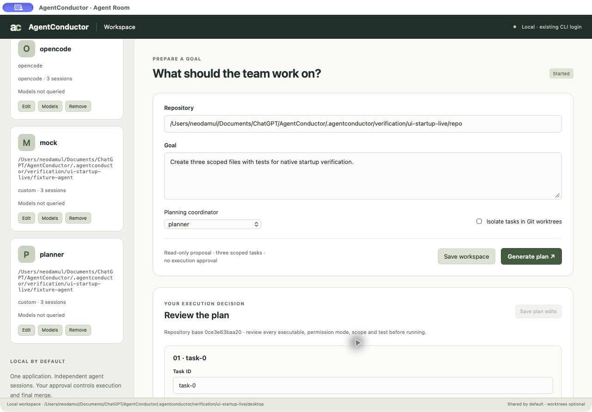

# AgentConductor

A local-first Rust orchestrator for coding CLI agents, designed to coordinate
Claude Code, Codex, OpenCode, and custom command-line agents.

Use your existing CLI authentication. AgentConductor does not require a separate
LLM API key or an OpenAI-compatible endpoint configuration.

- Assign scoped tasks in a shared workspace or optional Git worktrees.
- Collect structured output, logs, code changes, and test evidence locally.
- Review an integration candidate before approving its merge.
- Connect custom CLI agents through the same process I/O contract.

**Status:** In development. The CLI checkpoint is tested; full-product verification is ongoing. The Agent Room below shows a real local fixture run.

## Quick start

Build a single native executable with `cargo build --release`. Git and authenticated
agent CLIs are required. Workspaces are shared by default; use `"workspace_mode": "worktree"`
in the plan to isolate tasks.

```sh
agentconductor profiles profiles.json
agentconductor models-discover profiles.json claude /tmp/ac-claude-catalog
agentconductor models-discover profiles.json codex /tmp/ac-codex-catalog
agentconductor models-discover profiles.json opencode /tmp/ac-opencode-catalog
```

These are profile templates. Review permission settings before running. Codex uses its
native workspace sandbox. Claude, OpenCode, and custom profiles need an operator-verified
external sandbox or a read-only configuration; unrestricted profiles are rejected.
Model discovery uses existing CLI authentication and sends no generation prompt. If a
CLI cannot return a catalog, import an operator-observed catalog with `catalog-import`.
Available models and headless usage allowances depend on the provider/account.

An opt-in Claude profile with `permission_mode: "native_callback"` uses the pinned
stdin/stream-JSON control protocol. It requires the standard Claude profile arguments;
custom permission flags are rejected. Review typed tool requests while workers are idle:

```sh
agentconductor tool-requests /tmp/ac-run
agentconductor tool-approve /tmp/ac-run EXACT_REQUEST_SHA256 300
agentconductor tool-reject /tmp/ac-run EXACT_REQUEST_SHA256
agentconductor tool-refresh /tmp/ac-run EXACT_REQUEST_SHA256
agentconductor resume-due /tmp/ac-run
```

Approvals bind the task, session, plan, workspace evidence, exact input and decision
epoch. They expire within 900 seconds and permit one consumption. Refresh creates a
new pending request; it never renews approval. Rejected tools require revised instructions
or reassignment. Approving a stopped run does not resume it; use explicit `resume`.
Tool permission and final merge approval are separate. This opt-in integration has
compiled mock-protocol evidence; authenticated native tool enforcement remains unverified.
Its callback policy does not provide operating-system filesystem or network isolation.

Generate a three-task plan using a read-only coordinator, then review its agents,
owned paths, dependencies, and test commands:

```sh
agentconductor plan profiles.json codex /path/to/repo /tmp/ac-planning "Implement the goal"
agentconductor validate /tmp/ac-planning/plan.json
agentconductor run /tmp/ac-planning/plan.json /path/to/repo /tmp/ac-run APPROVED_PLAN_DIGEST
agentconductor status /tmp/ac-run
agentconductor diff /tmp/ac-run
agentconductor approve /tmp/ac-run EXACT_CANDIDATE_SHA
agentconductor merge /tmp/ac-run
```

Run directories must be outside the repository. Initial repository state must be clean.
The plan digest provides explicit consent to the exact plan. Merge approval binds the
candidate, base branch, diff, and passing test evidence. Edits revoke or invalidate approval.

## Sessions and temporary restrictions

Each task has an independent logical/provider session. A profile can run up to three
sessions concurrently; set `max_sessions` to reduce host load. Existing subscriptions
still share account limits. Profiles using the same account should share a `quota_group`.
The default group is the CLI executable.

```sh
agentconductor sessions /tmp/ac-run
agentconductor briefing /tmp/ac-run
agentconductor progress /tmp/ac-run TASK_ID
agentconductor schedule /tmp/ac-run TASK_ID 2026-10-11T09:00:00+09:00
agentconductor reassign /tmp/ac-run TASK_ID codex
agentconductor session-model /tmp/ac-run TASK_ID OBSERVED_MODEL_ID
agentconductor stop /tmp/ac-run "Review partial work"
agentconductor recover /tmp/ac-run
agentconductor revise /tmp/ac-run implementation "Address the missing edge case"
agentconductor resume /tmp/ac-run
agentconductor resume-due /tmp/ac-run
agentconductor watch /tmp/ac-run
```

Explicit reset times are retained. Unknown/ambiguous reset times require a manual schedule.
Scheduling applies to waiting sessions in the same account group. `watch` resumes due
work while it is running; stored schedules survive exit and are processed on the next
`watch` or `resume-due`. Automatic recovery allows three retries with a minimum delay;
explicit manual scheduling renews that retry allowance. Authentication/configuration
errors are retained for intervention rather than automatically retried.

Configure an optional `fallback` on a paid profile to transfer restricted work to a
registered company CLI. The execution plan review covers this policy:

```json
"quota_group": "company-codex-account",
"fallback": { "agent": "company-cli", "model": null }
```

The fallback must use a different account group and a verified execution capability.
Cycles and unobserved target models are rejected. Transfers wait for active attempts
to exit, preserve scoped partial files and logs, and start a new target session.
If the fallback is also restricted, work waits. Ordinary failures and operator stops
do not trigger this policy. Verification and human merge approval remain required.
The native profile editor offers per-agent fallback selection; a custom profile can
also be selected for all paid-agent fallbacks before saving and reviewing the plan.

A stop request terminates active task/test process groups and retains prior attempt logs and
partial files. Stopped runs require explicit `resume`; due-work scheduling cannot restart
them. Resume rechecks the Git baseline and requires fresh verification and merge approval.

After an interrupted coordinator, `recover` confirms that recorded processes and groups
are absent and returns the run to stopped state. It refuses recovery when ownership
evidence is missing, ambiguous, or still live. Recovery preserves session IDs and logs;
use `resume` separately after reviewing partial work.

Reassignment requires an idle coordinator and opens a new target-provider session with
scoped handoff evidence. Model changes require an observed catalog and an idle session.
Both require verification and a fresh merge approval. Prior attempts remain available.
Custom CLIs can use `{task_file}`, `{session_id}`, and `{model}` argv placeholders.

`progress` reads the current attempt's normalized events while the worker runs.
Results retain sequence numbers, raw byte offsets and native session IDs, and are
bounded to recent events (1,000 records, approximately 1 MiB). Full raw spools remain
in the attempt directory. Invalid JSONL stops the observed worker; intermediate
events do not imply successful completion. Memory summaries contain task/attempt/kind
metadata, without sending raw provider messages.

## Reviewed lessons

Keep a lesson as a JSON draft with `task`, `context`, `failure`, `cause`, `response`,
`evidence`, `confidence` (0–1), `revalidate`, and `sources` containing repository-relative
`path` and current content `sha256` values. Review it before promotion:

```sh
agentconductor knowledge-digest lesson.json
agentconductor knowledge-accept /tmp/ac-run lesson.json EXACT_LESSON_DIGEST
agentconductor knowledge-status /tmp/ac-run
```

Promotion requires an idle run. Reviewed lessons are stored in SQLite and mirrored to
the run's `knowledge/wiki` pages, index and log. Before reuse, source hashes are checked;
missing or changed sources make the lesson stale and exclude it from worker context.
Fresh lessons are scoped to their task and bounded to 8 KiB per handoff. They grant no
tool or merge permission. Local recall works offline; `memory-sync` delivers retained
reviewed summaries to an existing local agentmemory server when explicitly requested.

`revise` accepts up to 16 KiB of targeted feedback while the coordinator is idle. It
preserves the original task and prior evidence, invalidates affected dependents, and
requires new tests and approval. Changed dependencies refresh worktree contents while
retaining old checkouts and scoped partial work; preparation conflicts block execution.

Request a structured quality review from a registered read-only coordinator:

```sh
agentconductor review /tmp/ac-run codex
agentconductor apply-review /tmp/ac-run EXACT_PROPOSAL_SHA256
agentconductor resume-due /tmp/ac-run
```

`review` returns a proposal and its SHA-256 without applying feedback. Inspect the
saved proposal and evidence in `review-N/` before `apply-review`. Changed tasks or
evidence invalidate the proposal. `review-apply` explicitly enables immediate scoped
feedback application. Reviews are limited to three rounds per run and cannot grant
merge approval. Stopped runs retain inspection artifacts and require explicit resume
before another reviewer can start.

Local logs and test artifacts are under each run directory. `logs`, `normalize`, `recall`,
and optional `memory-sync` support inspection and local knowledge continuity.

## Agent Room

Open the native workspace to register CLI agents, enter a goal, generate and edit
a three-task plan, and explicitly approve execution:

```sh
agentconductor ui-new /path/to/local-workspace
# Or inspect an existing run:
agentconductor ui /tmp/ac-run
```

`ui` opens a native system WebKit window on macOS 11 or later. The embedded screen
communicates directly with the Rust controller through native messages. It does not
start a local web server or require a port, browser session, Node runtime or cloud
UI service. SQLite, logs and artifacts stay local. The CLI runtime currently requires Unix process safety primitives; native Windows
execution and desktop support are not yet available. The native desktop shell supports macOS.
Only one `ui` window can be open per run; close it before opening a replacement.

Select a task to inspect its live activity, raw logs, reviewed lessons and source
freshness. Send targeted feedback, reassign a role, choose an observed session model,
schedule a restricted session, stop, recover or explicitly resume a run. Actions
retain coordinator logs and report their actual exit status. Closing the interface
does not cancel an already launched coordinator; use **Stop run** to request stopping.

Use **Brief team** for a read-only snapshot of all task sessions, assigned work,
latest activity, report freshness, observed process presence, restrictions, review
requests and next actions. The same data is available through `briefing`. Unknown
or stale reports remain explicit, and process presence alone does not prove progress.
Company CLIs can publish bounded progress and acknowledge addressed requests through the [cooperative checkpoint commands](docs/11-cooperative-checkpoints.md). These commands retain task and approval authority in Rust.

The query launches no worker and contacts no LLM or memory server. Cooperative
agentmemory report collection is not yet connected; locally retained reports are
shown when available.

Session lists show green for running/completed work, yellow for waits and stops,
and red for failed/blocked work. Running lights pulse; reduced-motion settings
use steady lights. Text labels retain the exact state.

**Account capacity** lets you inspect any registered account and refresh Codex quota
through its authenticated CLI metadata channel. Independent windows show remaining
percentage, reset time, source and freshness. Missing or stale data is unavailable;
context tokens and estimated dollar costs are not account balance. Claude's verified
headless quota refresh is not yet available.

```sh
agentconductor quota-refresh /tmp/ac-run codex
```

Open **Diff & tests** to capture candidate evidence. A changed run requires a fresh
review. Candidate approval and final merge require separate confirmations; the engine
rechecks the exact candidate and test evidence. Tool requests show their typed input
and context before an explicit allow or deny decision. Usage and cost are displayed
only when reported by the provider.

The screenshot shows the working interface after a deterministic local fixture run,
including task feedback, reassignment, model selection, rerun, approval and merge.
The native window was captured using a local verification app wrapper around the same
Rust executable. It is runtime UI evidence, not native-provider execution evidence.
The native workspace supports profile registration, goal planning, scoped task edits
and plan approval. Planning requires a configured read-only coordinator.




## Runtime and distribution

The distribution target is a single native `agentconductor` executable, with
SQLite included. Git and the selected agent CLIs must be installed and authenticated
on the host. Optional memory and indexing integrations are separate services.

Choose a shared workspace or enable Git worktrees for separate code changes.
Execution permissions depend on the selected CLI and sandbox configuration.
