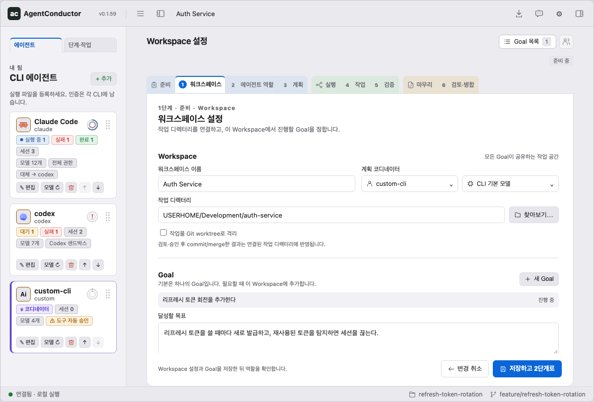
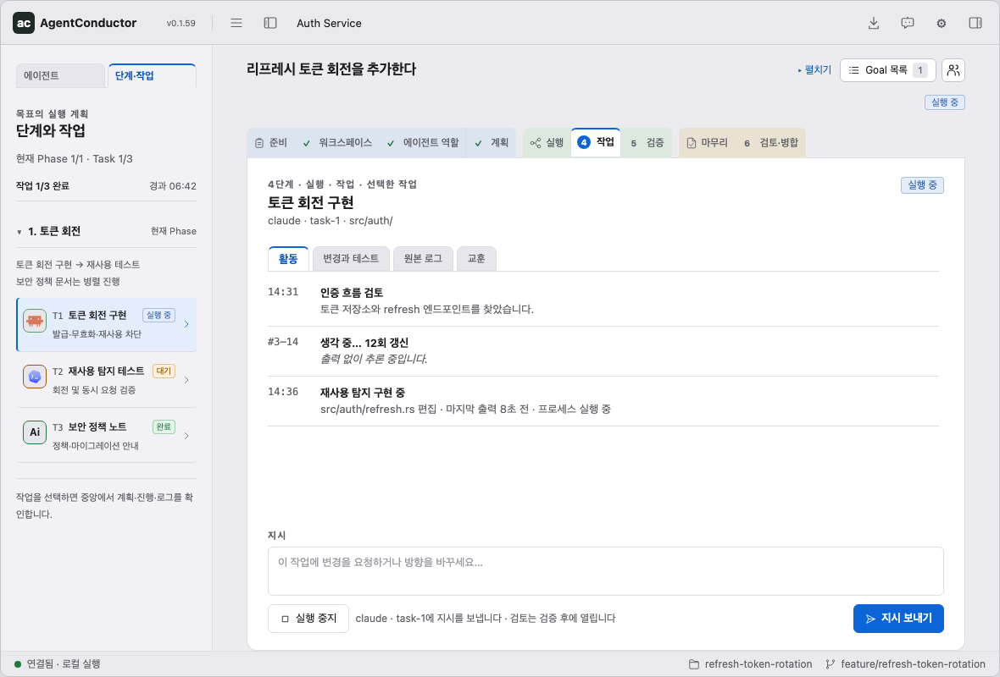
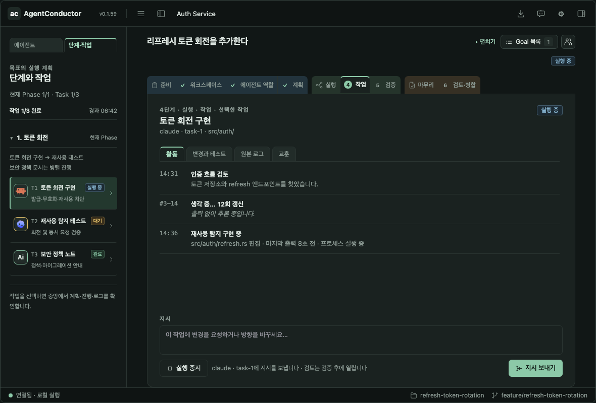
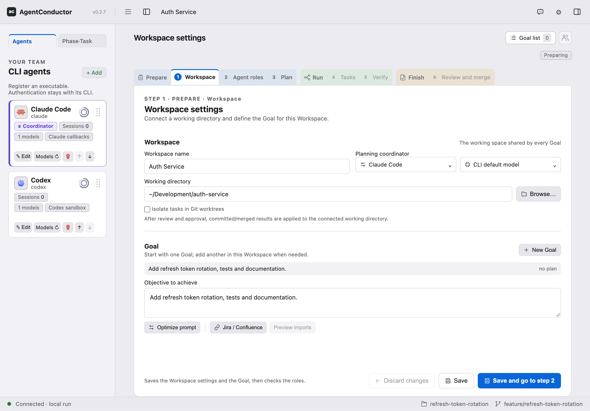
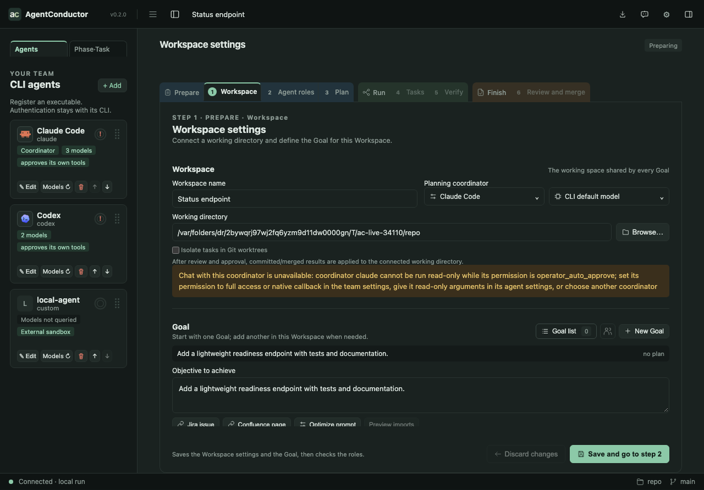
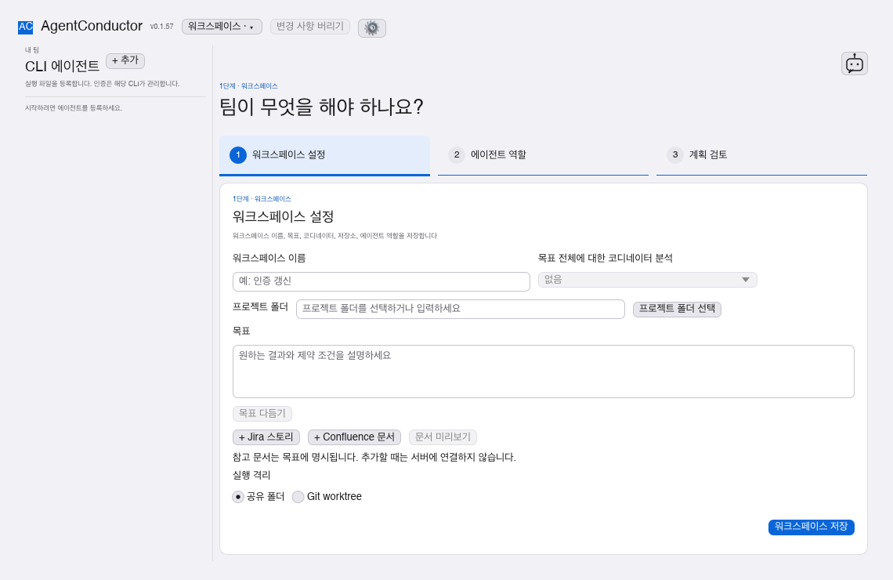
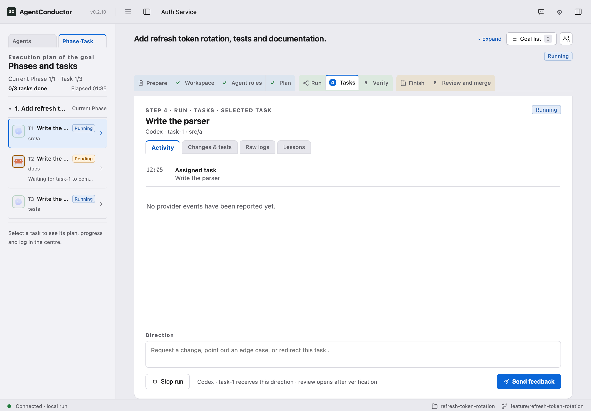
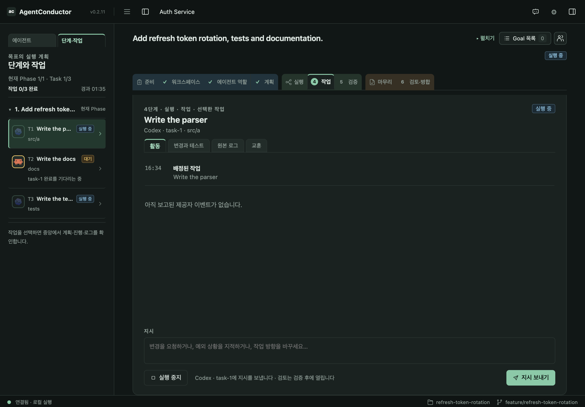
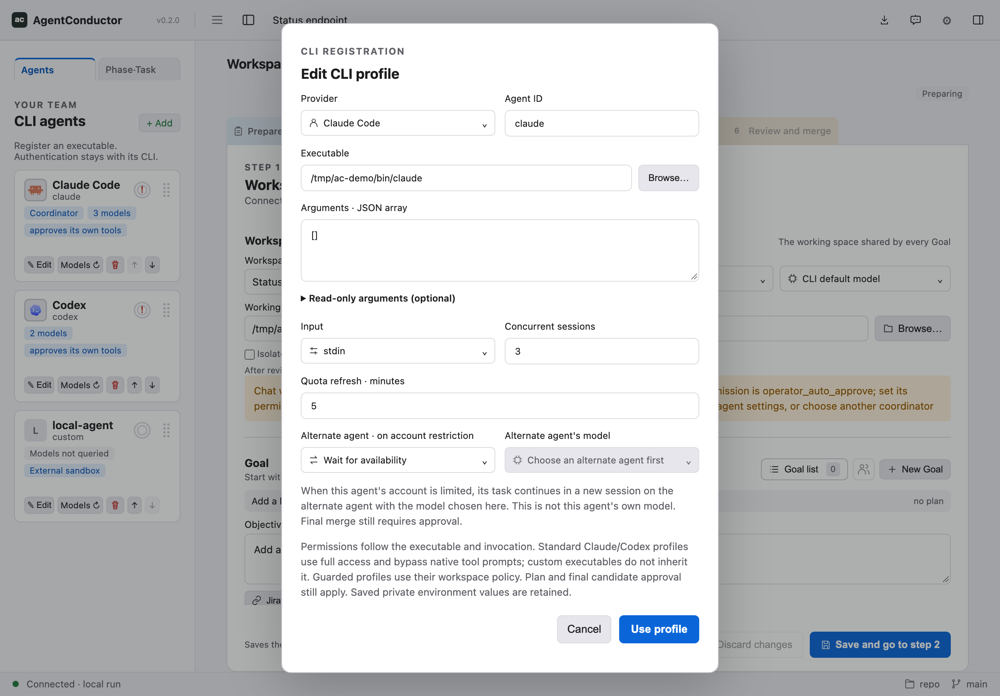
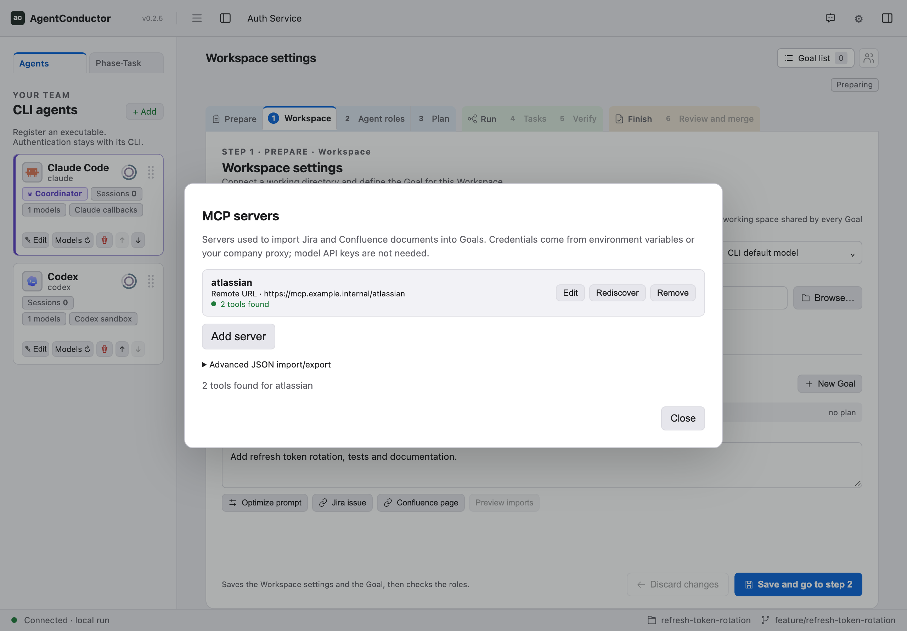

# AgentConductor

**A desktop app that lets several coding agents — Claude Code, Codex, OpenCode or your
company's own CLI — work on one repository as a team, while you stay in control.**

You describe a goal. AgentConductor splits it into scoped tasks, runs agents in parallel,
tests the combined result and asks for your approval before merging. It runs on your computer and reuses signed-in agent CLIs — no API keys, no cloud service.

## Interface previews and screenshots

The workflow images below are approved design mockups with sample workspace data; they show the intended layout and are not screenshots of a running session.

The following application UI images use local sample data; no live agents or projects are connected.

> **Version:** 0.2.5 · macOS (Apple silicon) and Windows (x86_64). Korean and light/dark themes are in **⚙ Settings**; **☰ → Help → User manual** opens the offline manual.

## What it does

- **One goal, a team of agents** — scoped tasks with dependencies, tests and their own agent sessions; files never overlap between tasks.
- **Mix agents and custom CLIs** — Claude Code, Codex, OpenCode or company commands, described by workspace JSON profiles.
- **You approve every important step** — the plan and the final merge; tool decisions are recorded.
- **Live team view** — status lights, a live line per running task (tool, time since last output, process state), readable multiline logs, Phase-scoped task history, diffs and tests.
- **Steer while it runs** — send feedback, reassign agents or models (even for tasks not started yet), stop and resume, or chat with the coordinator in a read-only chat (the chat-bubble button), and recover from an out-of-scope failure through a reviewed plan change.
- **Imports and lessons** — Jira/Confluence goal sources through company MCP servers, with automatic read-tool selection by the coordinator and saved per-server tool catalogs ([guide](docs/mcp-sources.md)); reviewed lessons are reused in later tasks.
- **Actionable bug reports** — open a standard GitHub issue draft in your browser, using the same public or internal repository configured for updates.
- **Local and private** — one native executable with SQLite inside; data stays local; checksum-verified updates from the Workspace menu. **agentmemory is optional.**

## How orchestration works

The **engine** (a built-in program, no LLM) starts agent sessions, enforces scopes and dependencies, runs tests, merges results into one candidate and records every step. The optional **coordinator** (an agent you pick) proposes the plan and reviews results; **Write plan manually** uses no LLM. The final merge always needs your approval.

## How roles are assigned

Set **Agent roles** per workspace (for example Claude for planning, Codex for development, another CLI for testing). The coordinator proposes tasks following those rules, you edit and approve the exact plan, and any task can be reassigned later; it continues from the work so far.

## When an account hits its usage limit

Agents sharing one subscription form a quota group. Work moves to a fallback agent you set, keeping partial files, or waits and resumes at the reset time the CLI reported. Remaining capacity is shown per agent; results need your approval again after any move.

## What you need

- macOS 11+ (Apple silicon) or Windows x86_64 (WebView2 Runtime, included in current Windows).
- Git for change history; your project can be an ordinary folder without a repository.
- At least one agent CLI installed and **already signed in**; two or more give you a team and a fallback.

## Getting started

1. Download the archive from [GitHub Releases](https://github.com/neodamul/AgentConductor/releases), check it against `SHA256SUMS`, extract it and open **AgentConductor**.
2. Press **+ Add** for each CLI you use, name the workspace, write the goal, pick a coordinator and a project folder, then **Save workspace**.
3. Review the tasks under **Agent roles** and press **Approve plan & run**.
4. Follow progress in the Agent Room, answer tool requests or send feedback, then review **Diff & tests** and approve the merge.

## Learn more

- Manuals: [English](docs/user-manual.md) / [한국어](docs/user-manual.ko.md); offline HTML: [English](docs/user-manual.html) / [한국어](docs/user-manual.ko.html).
- [Design documents](docs/README.md) / [UI design guide](docs/design-guide.md) — requirements, use cases and visual rules.

**License:** MIT — see [LICENSE](LICENSE).
