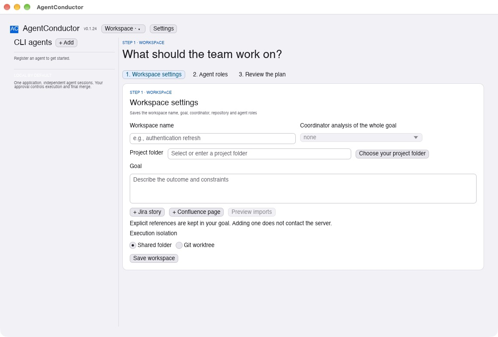
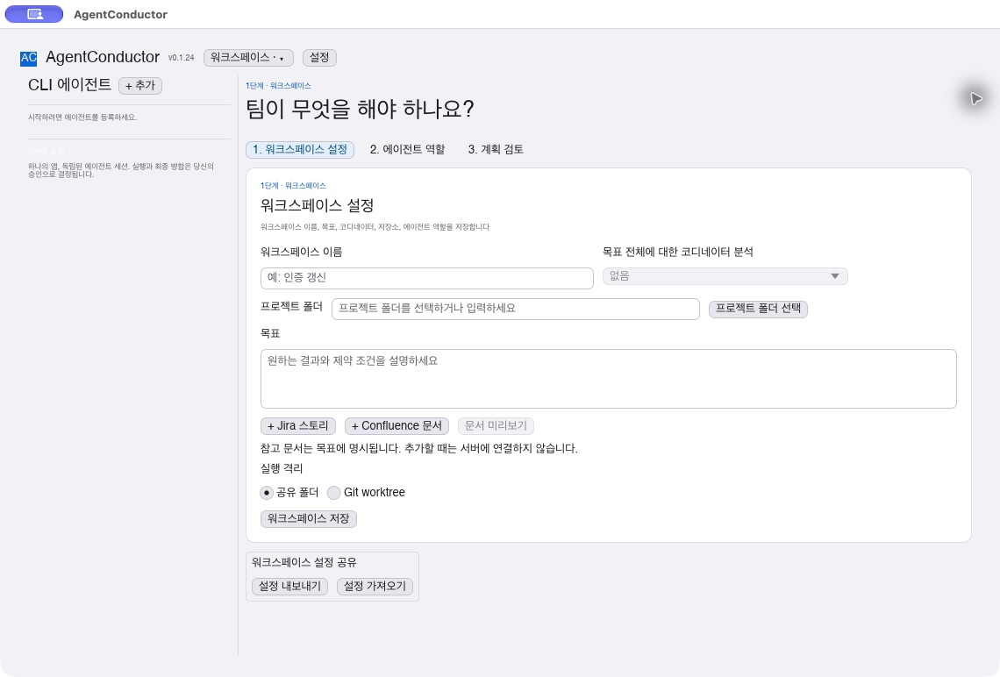
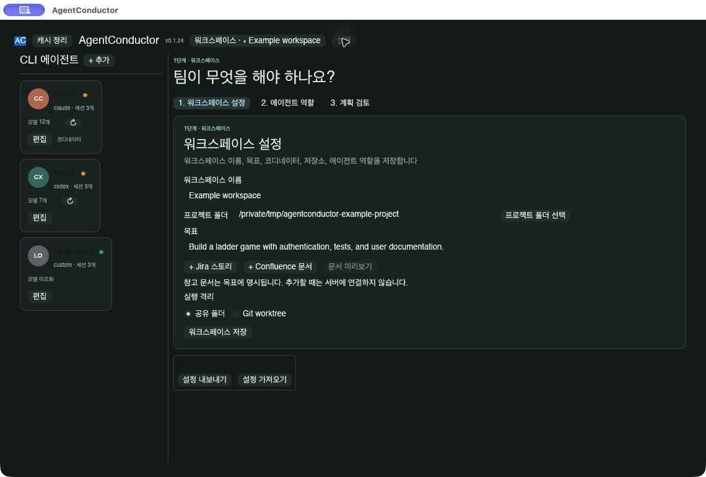
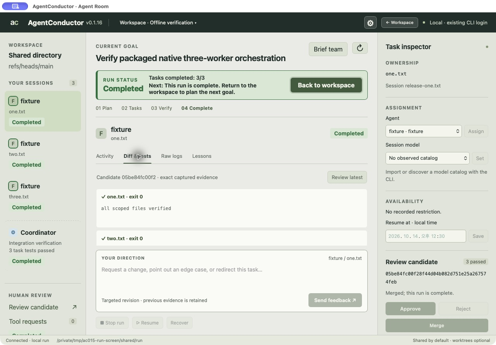
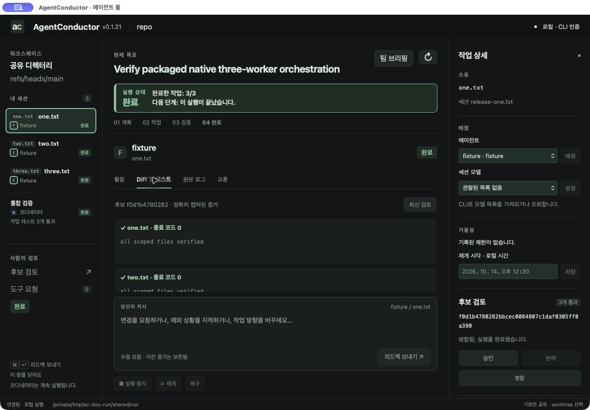
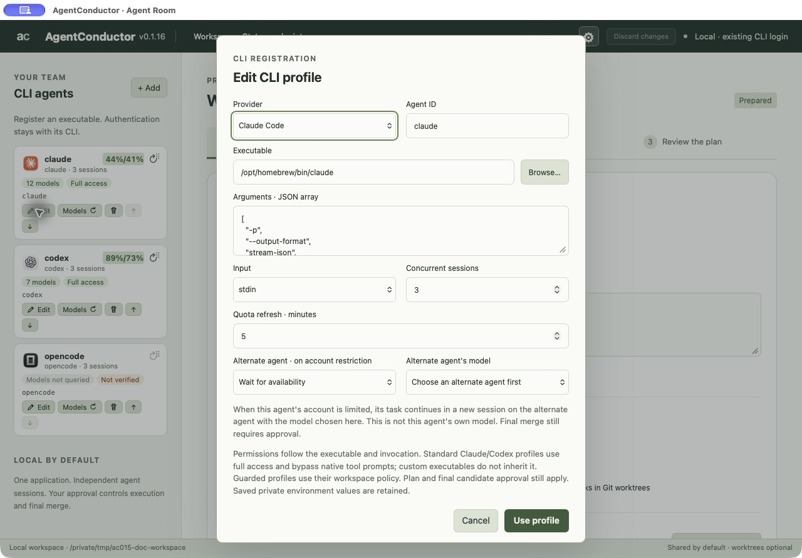

# AgentConductor

**A desktop app that lets several coding agents — Claude Code, Codex, OpenCode or your
company's own CLI — work on one repository as a team, while you stay in control.**

You describe a goal. AgentConductor splits it into scoped tasks, runs agents in parallel,
tests the combined result and asks for your approval before merging. It runs on your computer and reuses signed-in agent CLIs — no API keys, no cloud service.

> **Version:** 0.1.33 · macOS (Apple silicon) and Windows (x86_64). Korean and light/dark themes are in **⚙ Settings**; **Workspace ▾ → User manual** opens the offline manual.

## What it does

- **One goal, a team of agents** — scoped tasks with dependencies, tests and their own agent sessions; files never overlap between tasks.
- **Mix agents and custom CLIs** — Claude Code, Codex, OpenCode or company commands, described by workspace JSON profiles.
- **You approve every important step** — the plan and the final merge; tool decisions are recorded.
- **Live team view** — status lights, a live line per running task (tool, time since last output, process state), logs, diffs and tests.
- **Steer while it runs** — send feedback, reassign agents or models (even for tasks not started yet), stop and resume, or ask the coordinator in a read-only chat (the **?** button).
- **Imports and lessons** — Jira/Confluence goal sources through company MCP servers ([guide](docs/mcp-sources.md)); reviewed lessons are reused in later tasks.
- **Local and private** — one native executable with SQLite inside; data stays local; checksum-verified updates from the Workspace menu. **agentmemory is optional.**

## How orchestration works

The **engine** (a built-in program, no LLM) starts agent sessions, enforces scopes and dependencies, runs tests, merges results into one candidate and records every step. The optional **coordinator** (an agent you pick) proposes the plan and reviews results; **Write plan manually** uses no LLM. The final merge always needs your approval.

## How roles are assigned

Set **Agent roles** per workspace (for example Claude for planning, Codex for development, another CLI for testing). The coordinator proposes tasks following those rules, you edit and approve the exact plan, and any task can be reassigned later; it continues from the work so far.

## When an account hits its usage limit

Agents sharing one subscription form a quota group. Work moves to a fallback agent you set, keeping partial files, or waits and resumes at the reset time the CLI reported. Remaining capacity is shown per agent; results need your approval again after any move.

## What you need

- macOS 11+ (Apple silicon) or Windows (x86_64).
- Git for change history. Your project can be an ordinary folder; no repository or initial commit is required. Shared execution is default; worktrees are optional.
- At least one agent CLI installed and **already signed in** (Claude Code, Codex,
  OpenCode or a company CLI). Two or more give you a real team and a fallback.
- **agentmemory is optional.** Local history and lessons work without a memory server.

## Getting started

1. Download the macOS or Windows archive from [GitHub Releases](https://github.com/neodamul/AgentConductor/releases), check it
   against `SHA256SUMS` and extract it.
2. Open **AgentConductor**. The workspace window appears.
3. Press **+ Add** under *CLI agents* for each CLI you use. Templates fill in the details;
   standard Claude/Codex profiles use full access; custom CLIs handle their own tool approval unless explicitly restricted.
4. Name the workspace and write the goal. Under **Workspace settings** pick a coordinator
   and **Browse…** for an existing project folder, then **Save workspace**.
   Use **New goal** for the next feature in the same project; **Select goal** reviews earlier work. Switch between **Workspace settings**, **Agent roles** and **Review the plan** tabs.
   Choose **Generate plan** or **Write plan manually**. Ordinary folders use a snapshot for planning and work directly in the selected folder during shared execution, with history stored outside the project.
   Review diffs and tests, approve, then **Accept changes**; Git projects use **Merge**.
   The **Workspace** menu in the title bar creates and switches between named workspaces
   and offers adjacent **Export workspace** / **Import workspace** actions for reviewed sharing.

   

5. Saving the workspace opens **Agent roles**. Review the tasks and press **Approve plan & run**.
6. Switch freely between Workspace and Agent Room; live progress continues. Answer tool requests, send feedback, or reassign tasks.
   
7. Review **Diff & tests**; use the CLI for a full large patch, then approve and merge or accept the exact candidate.

## Learn more

- Manuals: [English](docs/user-manual.md) / [한국어](docs/user-manual.ko.md); offline HTML: [English](docs/user-manual.html) / [한국어](docs/user-manual.ko.html).
- [Design documents](docs/README.md) / [UI design guide](docs/design-guide.md) — requirements, use cases and visual rules.

**License:** MIT — see [LICENSE](LICENSE).
