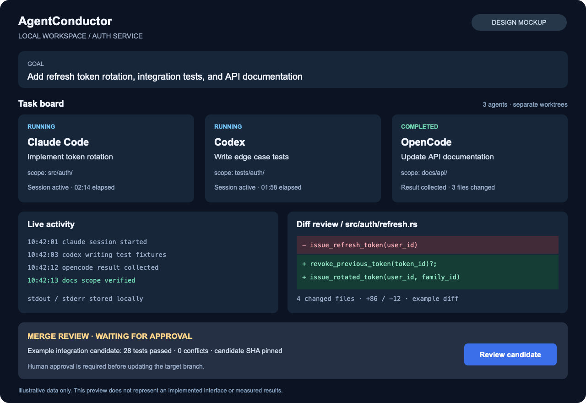
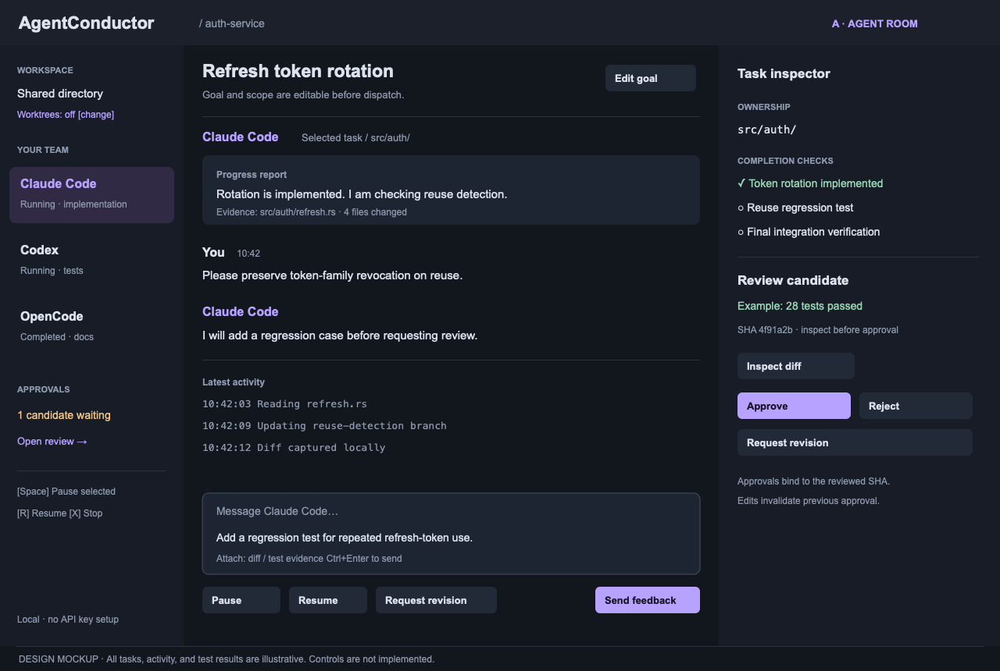
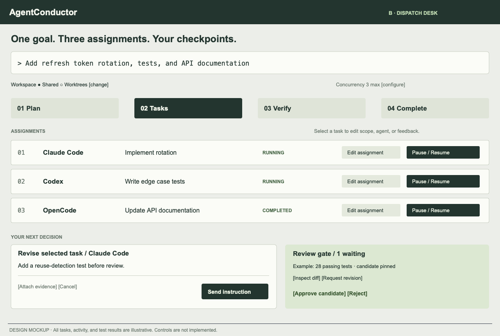
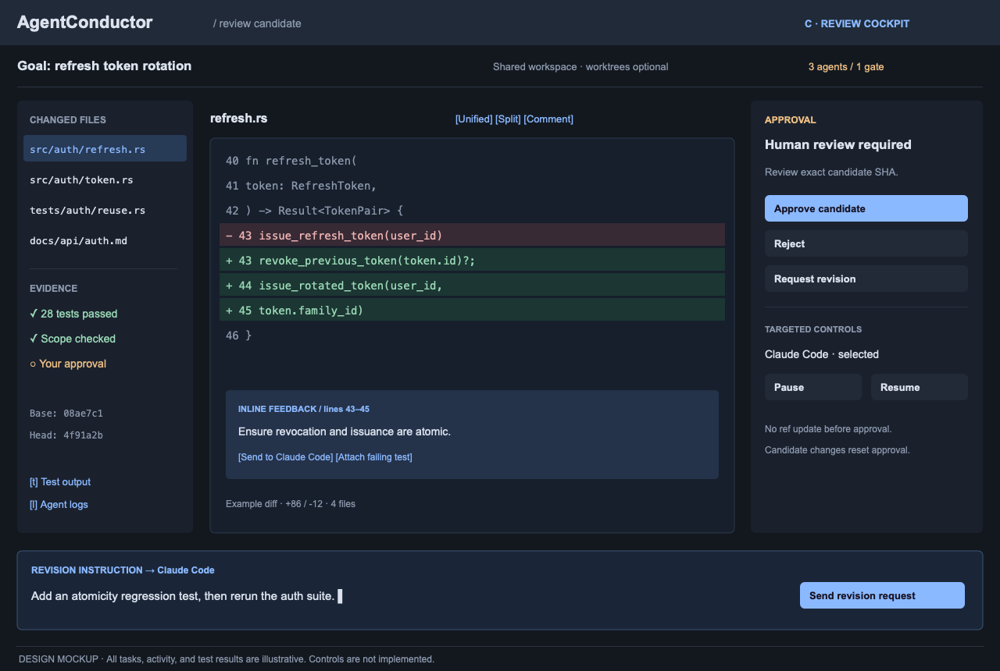

# AgentConductor

A local-first Rust orchestrator for coding CLI agents, designed to coordinate
Claude Code, Codex, OpenCode, and custom command-line agents.

Use your existing CLI authentication. AgentConductor does not require a separate
LLM API key or an OpenAI-compatible endpoint configuration.

- Assign scoped tasks in a shared workspace or optional Git worktrees.
- Collect structured output, logs, code changes, and test evidence locally.
- Review an integration candidate before approving its merge.
- Connect custom CLI agents through the same process I/O contract.

**Status:** In development. The CLI checkpoint is tested; full-product verification is ongoing. UI images below are design previews.

## Quick start

Build a single native executable with `cargo build --release`. Git and authenticated
agent CLIs are required. Workspaces are shared by default; use `"workspace_mode": "worktree"`
in the plan to isolate tasks.

```sh
agentconductor profiles profiles.json
agentconductor models-discover profiles.json claude /tmp/ac-claude-catalog
agentconductor models-discover profiles.json codex /tmp/ac-codex-catalog
agentconductor models-discover profiles.json opencode /tmp/ac-opencode-catalog
```

These are profile templates. Review permission settings before running. Codex uses its
native workspace sandbox. Claude, OpenCode, and custom profiles need an operator-verified
external sandbox or a read-only configuration; unrestricted profiles are rejected.
Model discovery uses existing CLI authentication and sends no generation prompt. If a
CLI cannot return a catalog, import an operator-observed catalog with `catalog-import`.
Available models and headless usage allowances depend on the provider/account.

Generate a three-task plan using a read-only coordinator, then review its agents,
owned paths, dependencies, and test commands:

```sh
agentconductor plan profiles.json codex /path/to/repo /tmp/ac-planning "Implement the goal"
agentconductor validate /tmp/ac-planning/plan.json
agentconductor run /tmp/ac-planning/plan.json /path/to/repo /tmp/ac-run APPROVED_PLAN_DIGEST
agentconductor status /tmp/ac-run
agentconductor diff /tmp/ac-run
agentconductor approve /tmp/ac-run EXACT_CANDIDATE_SHA
agentconductor merge /tmp/ac-run
```

Run directories must be outside the repository. Initial repository state must be clean.
The plan digest provides explicit consent to the exact plan. Merge approval binds the
candidate, base branch, diff, and passing test evidence. Edits revoke or invalidate approval.

## Sessions and temporary restrictions

Each task has an independent logical/provider session. A profile can run up to three
sessions concurrently; set `max_sessions` to reduce host load. Existing subscriptions
still share account limits. Profiles using the same account should share a `quota_group`.
The default group is the CLI executable.

```sh
agentconductor sessions /tmp/ac-run
agentconductor schedule /tmp/ac-run TASK_ID 2026-10-11T09:00:00+09:00
agentconductor reassign /tmp/ac-run TASK_ID codex
agentconductor session-model /tmp/ac-run TASK_ID OBSERVED_MODEL_ID
agentconductor stop /tmp/ac-run "Review partial work"
agentconductor recover /tmp/ac-run
agentconductor revise /tmp/ac-run implementation "Address the missing edge case"
agentconductor resume /tmp/ac-run
agentconductor resume-due /tmp/ac-run
agentconductor watch /tmp/ac-run
```

Explicit reset times are retained. Unknown/ambiguous reset times require a manual schedule.
Scheduling applies to waiting sessions in the same account group. `watch` resumes due
work while it is running; stored schedules survive exit and are processed on the next
`watch` or `resume-due`. Automatic recovery allows three retries with a minimum delay;
explicit manual scheduling renews that retry allowance. Authentication/configuration
errors are retained for intervention rather than automatically retried.

A stop request terminates active task/test process groups and retains prior attempt logs and
partial files. Stopped runs require explicit `resume`; due-work scheduling cannot restart
them. Resume rechecks the Git baseline and requires fresh verification and merge approval.

After an interrupted coordinator, `recover` confirms that recorded processes and groups
are absent and returns the run to stopped state. It refuses recovery when ownership
evidence is missing, ambiguous, or still live. Recovery preserves session IDs and logs;
use `resume` separately after reviewing partial work.

Reassignment requires an idle coordinator and opens a new target-provider session with
scoped handoff evidence. Model changes require an observed catalog and an idle session.
Both require verification and a fresh merge approval. Prior attempts remain available.
Custom CLIs can use `{task_file}`, `{session_id}`, and `{model}` argv placeholders.

`revise` accepts up to 16 KiB of targeted feedback while the coordinator is idle. It
preserves the original task and prior evidence, invalidates affected dependents, and
requires new tests and approval. Changed dependencies refresh worktree contents while
retaining old checkouts and scoped partial work; preparation conflicts block execution.

Request a structured quality review from a registered read-only coordinator:

```sh
agentconductor review /tmp/ac-run codex
agentconductor apply-review /tmp/ac-run EXACT_PROPOSAL_SHA256
agentconductor resume-due /tmp/ac-run
```

`review` returns a proposal and its SHA-256 without applying feedback. Inspect the
saved proposal and evidence in `review-N/` before `apply-review`. Changed tasks or
evidence invalidate the proposal. `review-apply` explicitly enables immediate scoped
feedback application. Reviews are limited to three rounds per run and cannot grant
merge approval. Stopped runs retain inspection artifacts and require explicit resume
before another reviewer can start.

Local logs and test artifacts are under each run directory. `logs`, `normalize`, `recall`,
and optional `memory-sync` support inspection and local knowledge continuity.

## Interface preview

The illustration below is a **design mockup**, not a screenshot of a working UI.
All task names, statuses, logs, and test results are illustrative.
The console concept includes task feedback, pause/resume, and explicit approval controls.



### Alternative views

All previews below are illustrative design mockups with planned interaction controls.
Open an image for the full-size view, or [browse the interface gallery](docs/interface-gallery.md).

| Agent room | Dispatch desk | Review cockpit |
|---|---|---|
| [](docs/assets/ui-agent-room.png) | [](docs/assets/ui-dispatch-desk.png) | [](docs/assets/ui-review-cockpit.png) |
| Direct task feedback and progress reports | Goal, assignments, and checkpoints | Code evidence and approval controls |

## Runtime and distribution

The distribution target is a single native `agentconductor` executable, with
SQLite included. Git and the selected agent CLIs must be installed and authenticated
on the host. Optional memory and indexing integrations are separate services.

Choose a shared workspace or enable Git worktrees for separate code changes.
Execution permissions depend on the selected CLI and sandbox configuration.
