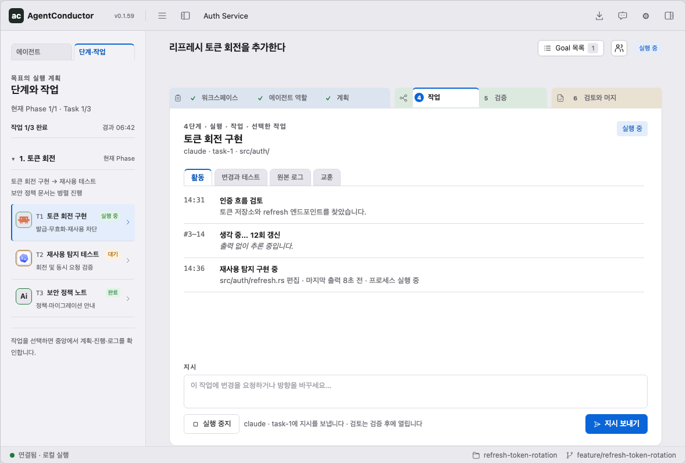
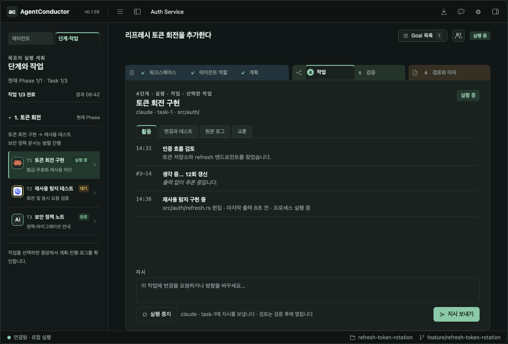
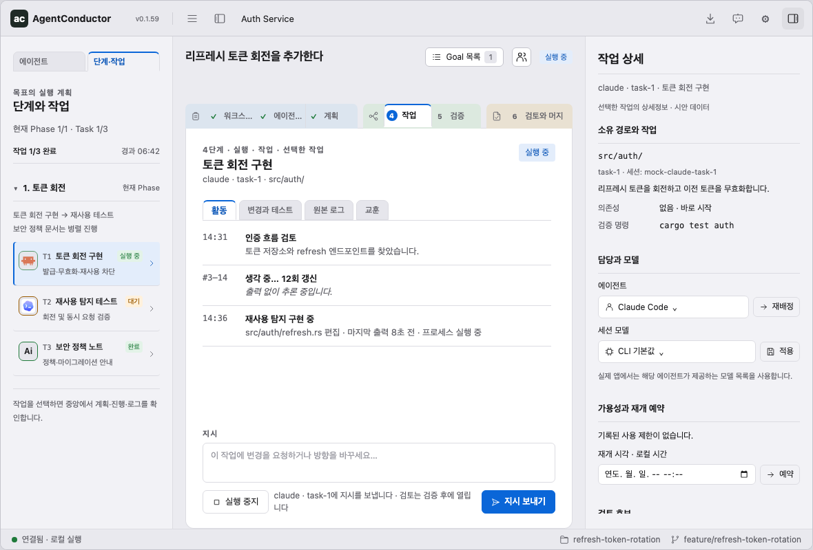
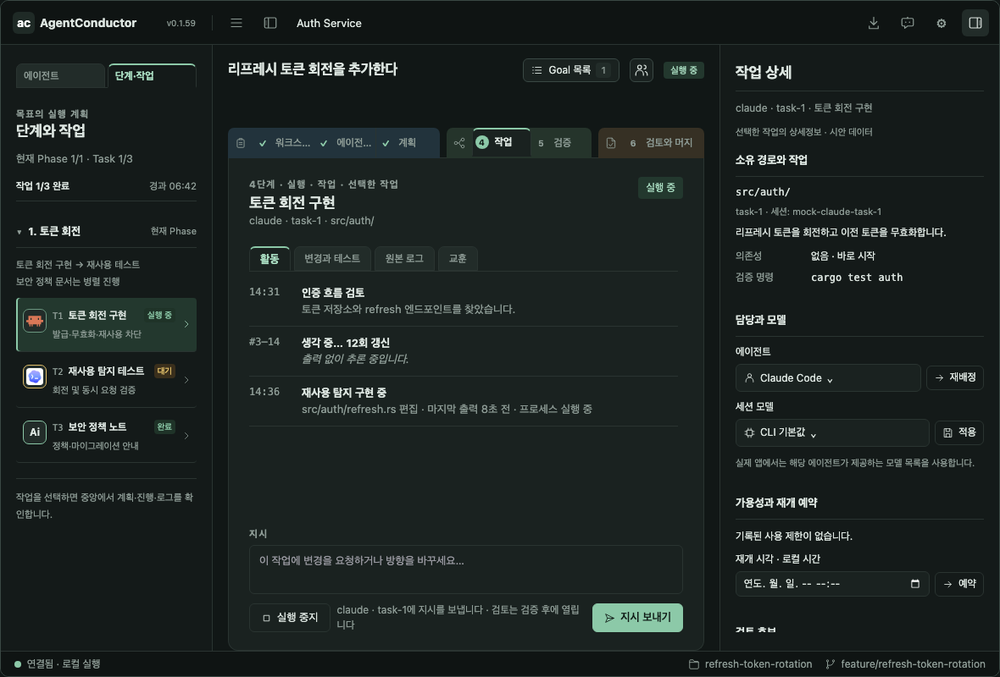

# Approved goal-screen design

**Approved:** 2026-11-04 (Asia/Seoul). **Scope:** design and interaction contract, not a released implementation.

This package freezes the user's reviewed goal-screen mock, including light and dark themes.
It supersedes the earlier layout and interaction descriptions in
[PR #388](https://github.com/neodamul/AgentConductor/pull/388).
Issue [#387](https://github.com/neodamul/AgentConductor/issues/387) tracks this design handoff.
Latest user-directed revisions are included in this package. The existing product remains the functional baseline: a visual redesign must preserve its capabilities.

## Read and preview

| Resource | Purpose |
|---|---|
| [Interactive reference](preview.html) | Open locally; arrows below the app frame switch ten scenarios |
| [Image gallery](gallery.html) | All scenarios and supplemental panels in both themes |
| [Behavior](behavior.md) | Layout, state, navigation, actions, and exceptional states |
| [Visual specification](visual-spec.md) | Dimensions, typography, tokens, icons, motion, and themes |
| [Architecture delta](architecture.md) | Requirement-to-design trace and backend boundaries |
| [Acceptance and evidence](acceptance.md) | Checklists, coverage, limits, and reproducible checks |
| [Claude handoff](handoff.md) | Implementation boundaries and differences from the earlier draft |
| [Verification data](verification.json) | Source hashes, screenshot hashes, scenario labels, checks, and contrast |

Open `preview.html?theme=dark#3` for the dark task screen.
Settings also includes a local light/dark selector. Right task details always start closed.
The preview's arrow controls are design tooling; do not ship them in the application.

## Approved overview

### Light

### Dark

### Task inspector: docked, not a slide-over

## Decisions that override the earlier draft

- Workspace owns Goals and links one working directory. A Goal owns its plan, phases, tasks, and results.
- Goal is the user-facing term. Slug is an internal folder identifier, not another workflow stage.
- The left rail has **Agents / Phases & tasks**, in that order. Planning and execution select the task rail.
- Agent progress uses icon borders and a running pulse; do not add a permanent progress sentence to cards.
- Executable paths and a fixed "three sessions" label are absent from cards; editing still exposes executable configuration.
- Quota uses a compact dual-ring icon; details, reset time, refresh, unsupported states, and errors open on click.
- Goal list, team briefing, coordinator chat, and settings are slide-overs.
- Task details are a **docked third column**, default closed, toggled only with the titlebar panel icon.
- There is no task-details tab in the body and no X/Close control inside the docked inspector.
- Completion is one detailed centered popup, reused by both merge completion and Goal-list results.
- The step description header and action footer remain fixed; only the body between them scrolls.
- Header order, compact spacing, overflow tooltips, and light/dark parity are specified, not optional styling choices.
- Anchored lists are the choice-control standard throughout; roles retain Agent/Model → Fallback/Model.
- Neutral desktop tabs keep Prepare/Run/Finish icons integrated inside their shared background groups, with no extra caption row.
- Status borders are 1.5px; fullscreen preserves logical control sizes; quota-window colors match popup details.

## Scope boundary

The preview uses fabricated sessions, quota, timings, tests, and commits. It neither executes agents
nor modifies repositories. Folder links are example `file:` links, not native Finder/Explorer integration.
Deleting a Goal removes an in-memory preview entry only; no disk files are deleted.
Update checking, model discovery, role reassignment, scheduling, and MCP calls are not implemented here.

HTML/CSS/JavaScript and the capture utility in this directory are **documentation artifacts**.
They must not be packaged or embedded as the Rust application's UI.
The paused Rust development goal remains paused; approval of this design does not resume it.

## Document delivery workflow

- [x] Plan: reconcile the user's final decisions with the previous draft and existing UI.
- [x] Task: preserve the interactive reference and write behavior, visual, architecture, and handoff documents.
- [x] Verify: both-theme captures, source/image hashes, and local interaction checks.
- [x] Completed: prepare the reviewable package for commit/push and record the Claude handoff contract.

Implementation acceptance is a separate workflow and remains open. Do not mark product features
complete merely because a screenshot or a preview action exists.
