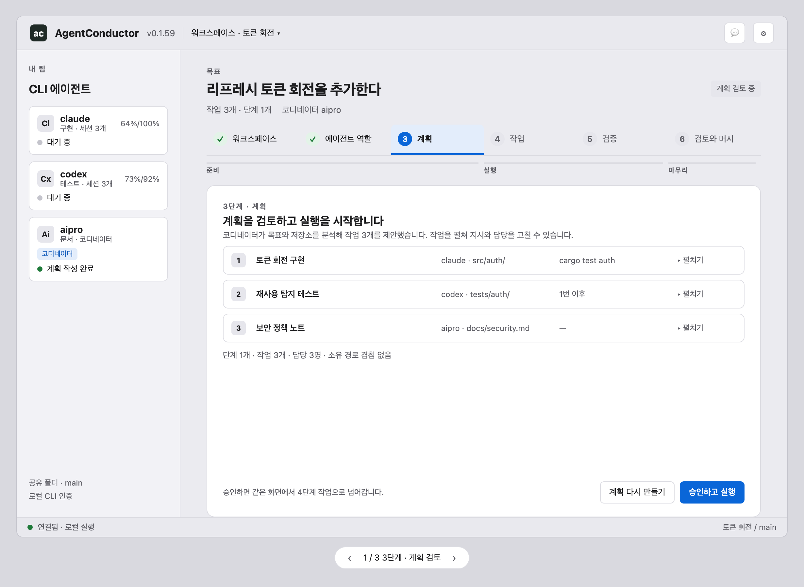
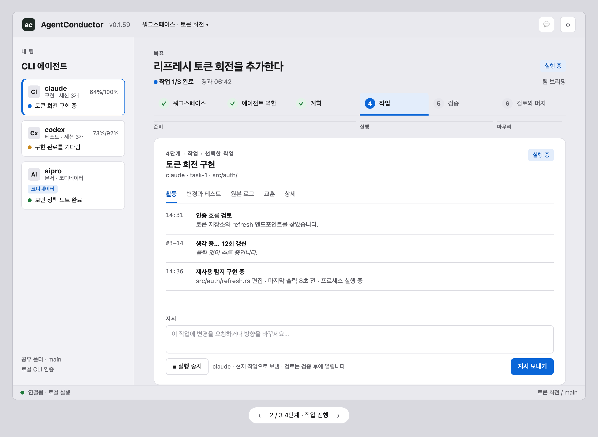
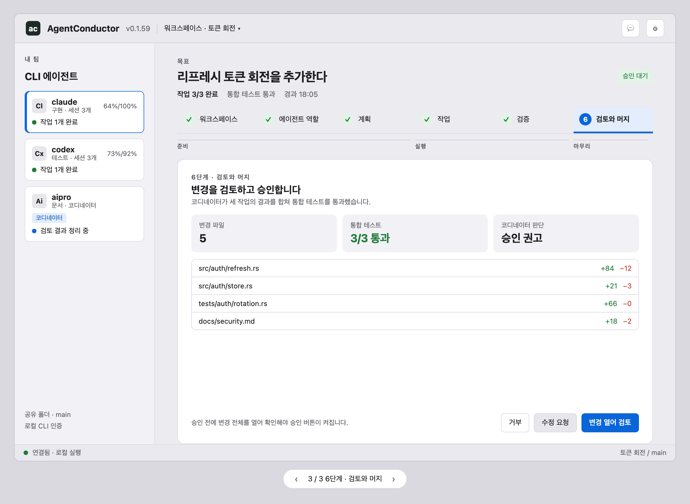
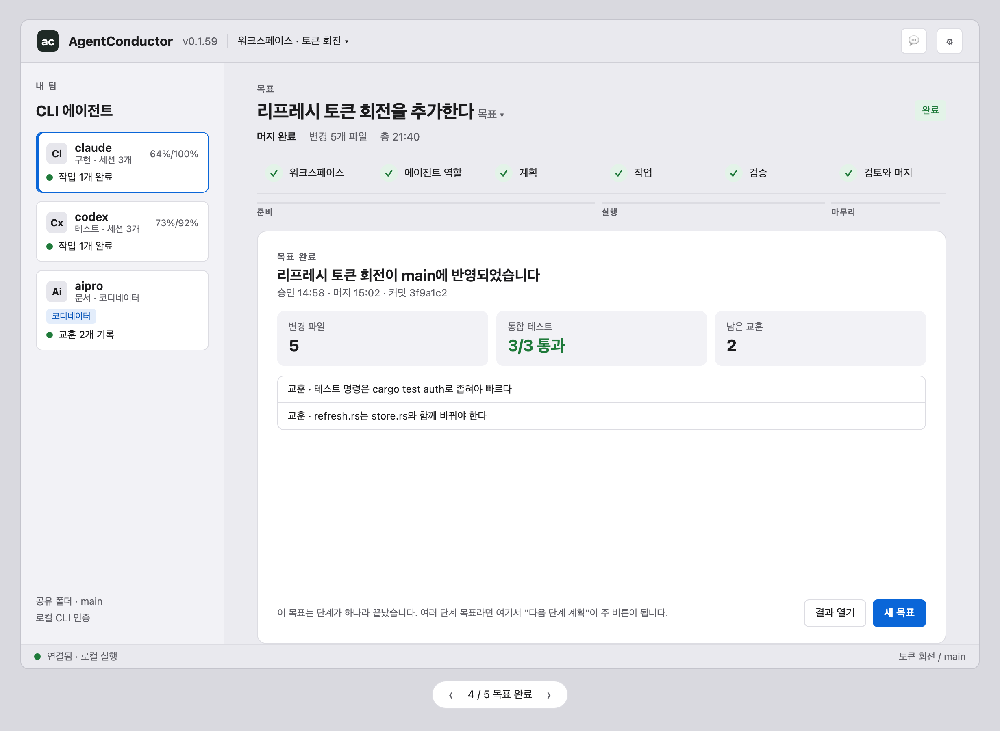
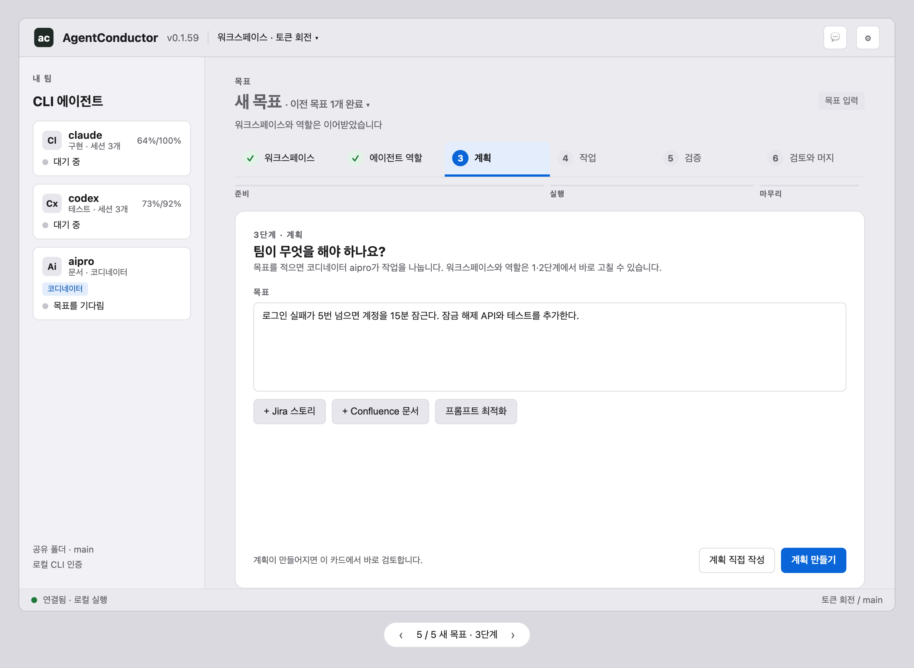

# One goal screen with a single stepper (GitHub #387)

Status: design, approved for handoff 2026-11-03. Owner of the Rust UI port: Codex (#9 split: #365, #370, #373, #374). The JS UI follows the same design.

## Problem
The workspace screen (1 Workspace settings · 2 Agent roles · 3 Review the plan) and the Agent Room (Plan · Tasks · Verify · Merge) are two screens that count the same goal twice, use different layouts (two vs three columns), and scatter actions over four places.

## Design
- **One screen per goal, one stepper:** 1 Workspace → 2 Agent roles → 3 Plan → 4 Tasks → 5 Verify → 6 Review and merge, grouped as prepare (1–3), run (4–5) and finish (6). Done steps show ✓, the current step is highlighted, and done steps open read-only while a run works. There is no "← Workspace" switch.
- **One left list:** the CLI agents list stays in every step. Each card shows the agent, its quota and one live line (idle, the task it works on, waiting, done).
- **One card per step:** each step uses the same card: eyebrow "Step n · name", a title, a one-line explanation, the body, and one action row at the bottom right. Only the next action is primary (Approve and run, Send direction, Open changes to review, New goal).
- **Step 4:** activity, changes and tests, raw logs, lessons and details (today's task inspector) are tabs of the selected task card. The Activity tab keeps R-120's folded thinking line and R-159's facts.
- **After step 6:** the card becomes "Goal done" (result, tests, lessons). The primary action is "New goal", or "Plan the next phase" when phases remain (R-56, R-195). A new goal keeps steps 1–2 (workspace-level settings, ✓ and editable) and starts at step 3. Finished goals stay listed under the title (R-55, R-150).

## Screens
Rendered from `unified-goal-screen.html` (the app's own color tokens and sizes; arrows switch the states):

| State | Image |
|---|---|
| Step 3 · plan review |  |
| Step 4 · tasks |  |
| Step 6 · review and merge |  |
| Goal done |  |
| New goal · step 3 |  |

## Traces it touches
R-38 (workspace settings), R-45/R-196 (visible progress), R-99/R-111 (next step always shown), R-104 (activity), R-112/R-195 (phases), R-118 (close dialog), R-120/R-159 (activity facts), R-165 (inspector folding is replaced by tabs), R-180 (only useful information). A requirement entry (next free number on `main`, see docs/README.md reserved block) is added when implementation starts.

## Implementation order (suggested)
1. Single stepper and card on both pages.
2. One agent list with live lines.
3. Remove the screen switch (the run renders in steps 4–6 of the same page).

## Specification

### Step from state
The stepper position is derived, never stored. The first matching row wins.

| Condition (startup snapshot / run report) | Step | Card |
|---|---|---|
| No project folder or no saved workspace name | 1 | Workspace settings (today's step-1 card) |
| No coordinator, or a role rule refers to a missing agent (R-101 red assignment) | 2 | Agent roles |
| No goal, or `job.kind == "plan"` running, or a proposal not yet approved | 3 | Goal entry → planning progress → plan review |
| Run `state` in `ready`, `running`, `waiting_tool_approval`, `waiting_availability`, `stopped`, `blocked`, or a task `failed`/`permission_denied` before integration | 4 | Tasks |
| All tasks `completed` and integration verification running or failed | 5 | Verify |
| `waiting_approval`, `approved`, or merge job running | 6 | Review and merge |
| `completed` (merged) | — | Goal done |

Steps 1–2 belong to the workspace and keep ✓ across goals. Steps 3–6 belong to the current goal (slug) and its current phase.

### Layout and reuse
- **Title bar:** today's (`.titlebar`), without the "← Workspace" button. The run phase label (R-114) moves into the goal meta line.
- **Left list:** `.startup-team` with `.startup-profile` cards. Add one live line per card: status dot (R-29 colors) plus text from the run snapshot `activity`, task status and quota restriction. Selecting an agent with work selects its task in step 4.
- **Goal header:** eyebrow, `h1` goal, one `.status-pill`, and a meta line (`n/m tasks`, elapsed, phase). "Brief team" moves into this meta line.
- **Stepper:** `.startup-tabs` extended to six tabs, with the group labels prepare / run / finish under it. A done step opens read-only while a run is active.
- **Card:** `.step-card` with `.section-title` (eyebrow `Step n · name`, `h2.step-title`, `p.step-intro`), then the body, then one action row (`.dialog-actions`-like, right aligned, one `.primary`).

### Per-step body
- **Step 3:** goal textarea, Jira/Confluence/optimize buttons and planning progress (R-45/R-196). Then the folded task rows (R-116) and phase briefs (R-117). Primary: Generate plan → Approve and run. Secondary: Write plan by hand, Regenerate.
- **Step 4:**
  - **Top:** the selected task title, its agent, task id and owned paths.
  - **Tabs:** Activity (R-104, R-120 fold, R-159 facts), Changes and tests, Raw logs, Lessons (R-164), Details (ownership, assignment, model, availability; today's inspector).
  - **Bottom:** the direction box (R-172).
  - **Actions:** Stop run is secondary on the left. Send direction is primary. A tool request, permission denial or blocked task turns the primary action into the decision it needs (Allow/Deny, Resume, Recover).
- **Step 5:** the integration entry (R-105/R-109) as the body: the test list with exit codes, the coordinator judgments (R-167), and Fix with feedback on failure (R-110).
- **Step 6:** stat tiles (changed files, integration tests, coordinator verdict) and the file list. Primary: Open changes to review → Approve → Merge/Accept (R-111, R-156). Secondary: Reject, Request changes.
- **Goal done:** result, tests and lessons. Primary: New goal, or Plan phase n+1 when phases remain. Secondary: Open result.

### Exceptional states (inside the current step, never a separate screen)
- **Tool request waiting:** an amber notice in the card, plus Allow once / Deny as the action row (R-30/R-106).
- **Permission denied (#341):** a red notice with the tool and message, plus "Change the CLI's configuration, then Resume".
- **Availability wait:** a notice with the reset time and Schedule/Reassign (R-127).
- **Stopped / interrupted:** the banner text plus the interruption history (R-120). Primary: Resume or Recover.
- **Closing the window while running:** the R-118 dialog, unchanged.

### Accessibility and language
- The stepper is a `tablist` with roving `tabindex`, and each step has `aria-current="step"`.
- Card actions are reachable in order, and the primary action is last.
- All text comes from the message catalogs (English and Korean). The new keys are prefixed `goal.`.

### Acceptance tests
- A pure function maps each row of the step table to its step. Test it in Node with one snapshot per row.
- A rendered page shows exactly one `.primary` per step, and no "← Workspace".
- Approving a plan moves from step 3 to step 4 without a page or screen switch.
- A finished goal offers New goal. A goal with phases left offers Plan phase n+1.
- Both themes, both languages; source files stay under 500 lines (`source_layout`).
