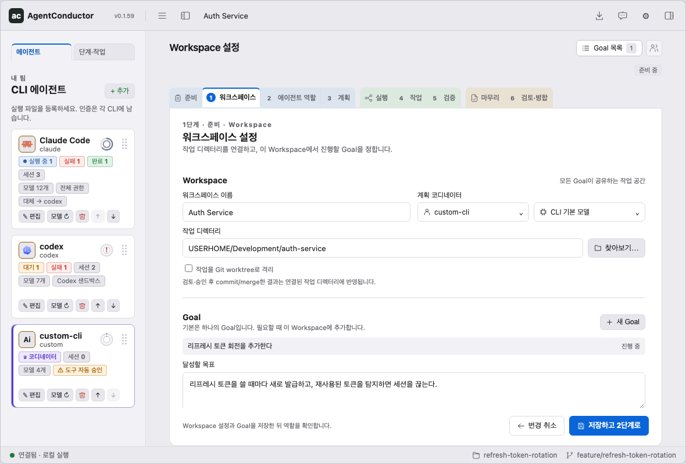
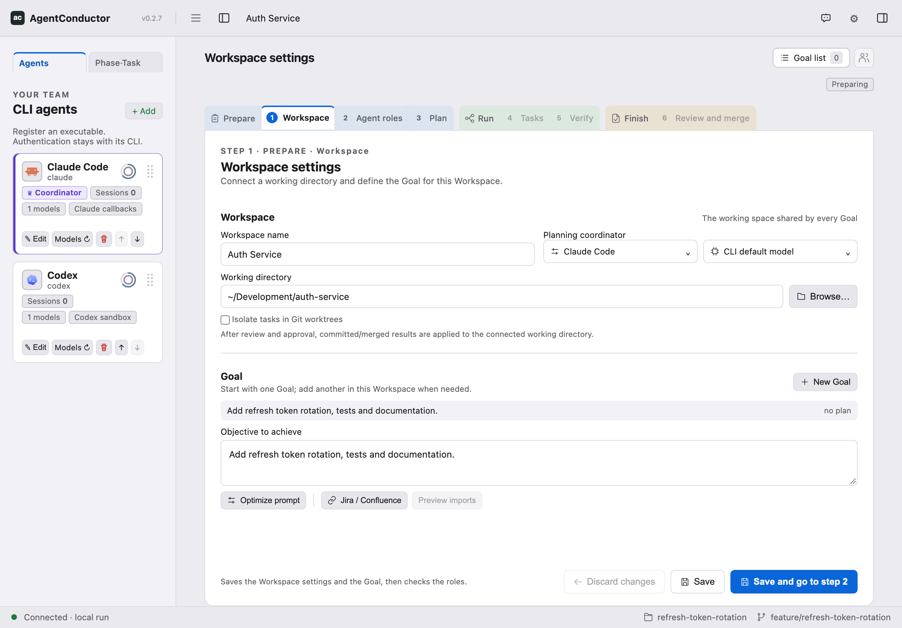
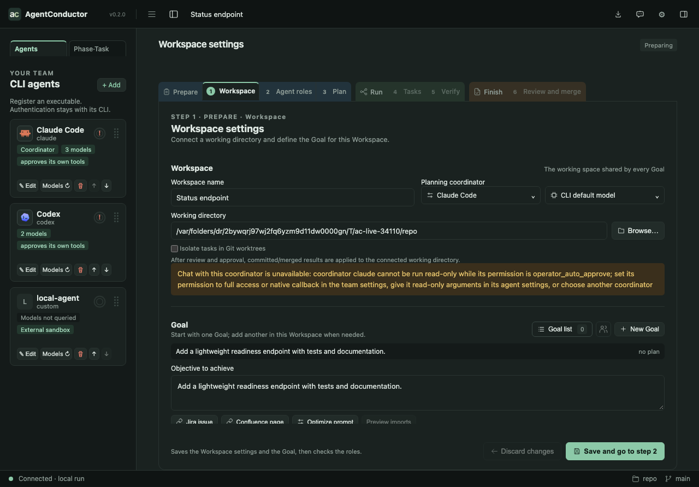
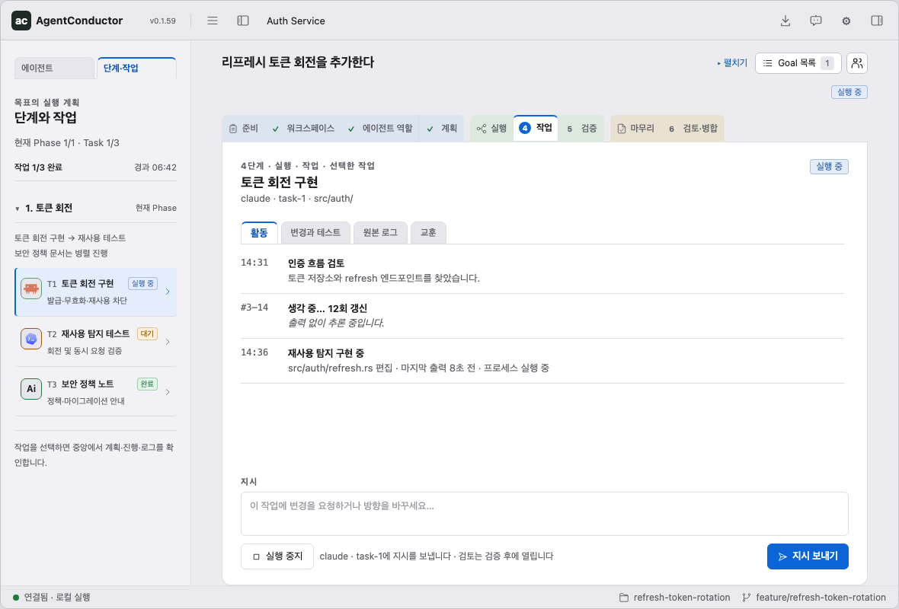
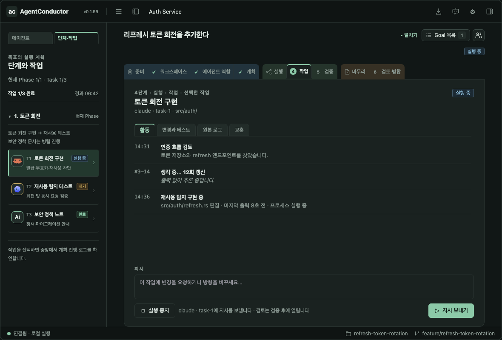
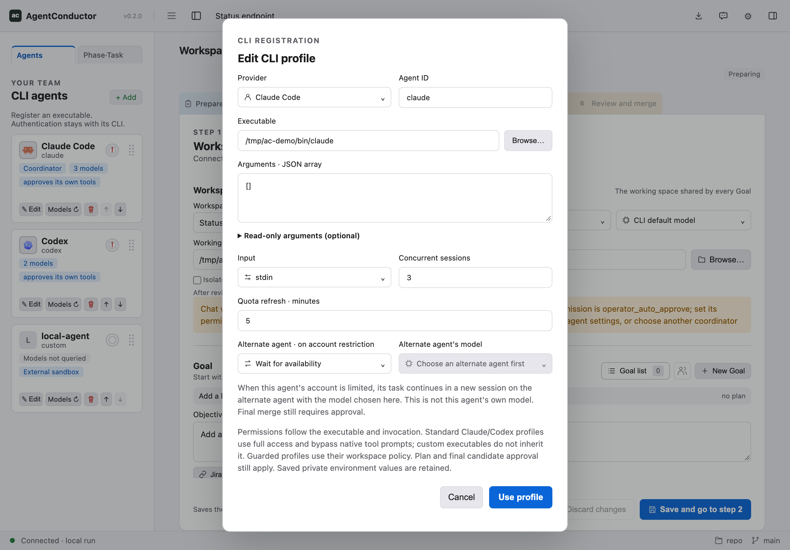
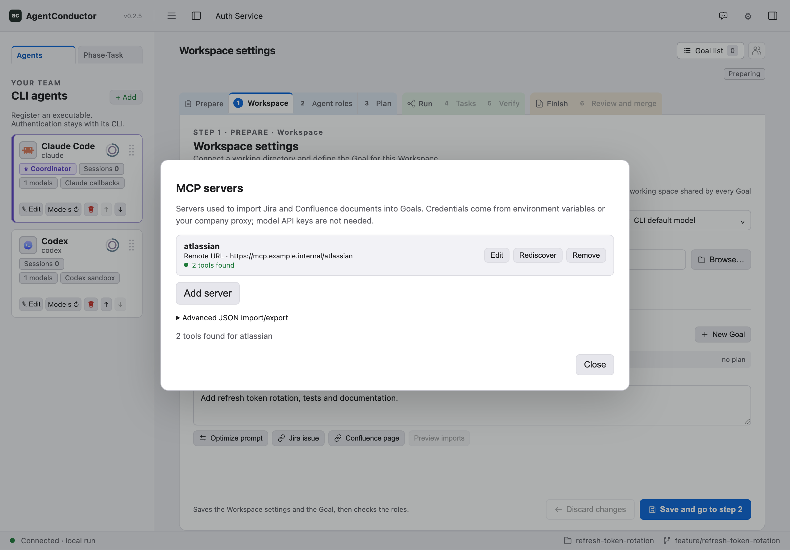
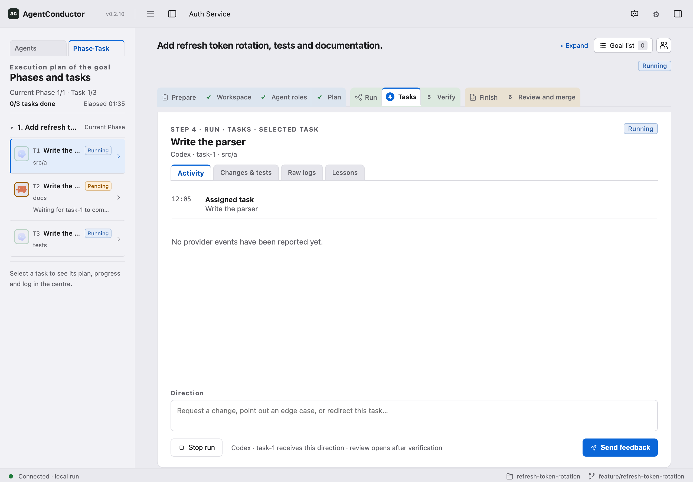
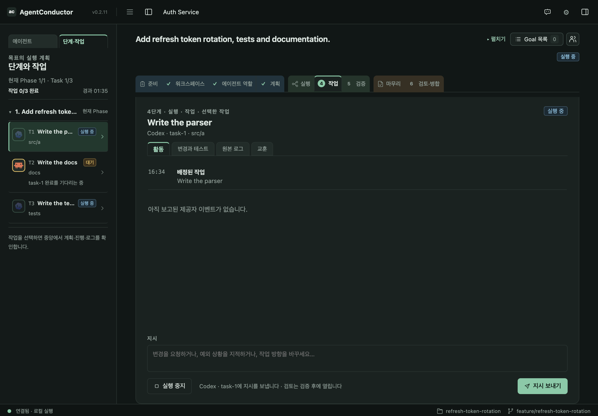

# AgentConductor User Manual

Version **0.2.9** · [한국어](user-manual.ko.md) · [Short introduction](../README.md)

## Part 1 — Desktop application

### 1.1 Requirements and installation

Use macOS 11+ on Apple silicon, or Windows x86_64 with WebView2 Runtime. Install Git and
at least one coding CLI, already signed in: Claude Code, Codex, OpenCode or your company CLI.
Projects can be ordinary folders; a Git repository and initial commit are optional.
There is no model API key registration or local UI web server.

Download your platform archive and `SHA256SUMS` from GitHub Releases. Verify the archive,
extract it and open `AgentConductor.app` or `agentconductor.exe`.
Packages include the standalone executable, both manuals, screenshots, dependency licenses and SBOM.
The app version is beside the title. Version 0.2.9 uses one six-step stepper for Workspace settings and the Agent Room, a two-tab left panel (Agents, Phase·Task), quota rings, slide-overs for the Goal list, the team briefing, the coordinator chat and Settings, a centered result popup when a goal completes, and status borders on agent icons. The approved design previews below show the intended workflow with sample data; they are not screenshots of a running session.

### 1.1a Application updates

The app checks GitHub Releases in the background every **10 minutes**. A newer installable release shows an update icon left of Settings. Choose **☰ → Help → Check for updates…**, read the scrollable release notes beneath the link, inspect the current/latest versions and choose **Update and restart**. Finish or stop runs and active app jobs first; the desktop refuses installation while any saved workspace has running work.

**Settings → GitHub repository** chooses where updates come from: a GitHub `owner/name`, or an `https://host/owner/name` URL of an in-house GitHub-compatible server. Leave it empty for the default. Release notes, the archive and `SHA256SUMS` come from that repository's latest release, so only use a repository you trust.

The installer downloads the matching macOS/Windows archive and its `SHA256SUMS`, checks the archive hash, replaces the executable or macOS bundle and restarts with the same arguments. It needs `curl`, access to GitHub and permission to write the installation location. On failure, inspect the update dialog; do not assume a newer version was installed.

`agentconductor update` installs a newer release over the executable without restarting it; finish or stop work before running the command. The current updater makes unauthenticated GitHub requests and does not reuse GitHub CLI credentials: private or restricted releases require manual download with your authorized browser or GitHub CLI. Do not add model API keys for application updates.

### 1.1b Bug reports

Choose **☰ → Help → Report a bug…**. The default browser opens the configured GitHub repository's issue editor with sections for the summary, reproduction steps, expected/actual behavior and version/OS/architecture. Sign in to GitHub if requested, finish the report and submit it there. Opening the editor does not create an issue. Paths, logs, Goals and agent conversations are not attached automatically. **☰ → Help → Release notes** opens the release page of the running version on the same repository.

The target uses **Settings → GitHub repository**, shared with application updates. Set `owner/name` or an Enterprise `https://host/owner/name` URL; leave it empty for the default repository.

### 1.2 Workspaces and settings

Application images below render the current product UI with deterministic local sample data in the browser verification harness. They do not show signed-in agents or a live project run. Approved design previews are labeled separately.
You can create, open and switch workspaces while planning or a run is in progress. The previous workspace keeps working in the background; reopen it from **☰ → Workspace** to read its current plan, progress and logs. Saved settings and execution evidence stay with that workspace. Switching does not stop or approve work. Finish or stop active work before deleting its workspace. Export/import continues to share the reviewed workspace configuration archive; it does not transfer live processes.


A workspace holds goals, plans, role assignments and local history. Name it, choose an
existing project folder with **Browse…** or type the path, then **Save workspace**.
Git worktree isolation is optional; shared execution is the default.
Choose **Save** to persist edits and stay on Workspace, or **Save and go to step 2** to save and open **Agent roles**. Empty or invalid required controls have a red border until corrected; a CLI default model is valid. When the Goal has unapplied Jira/Confluence references, saving succeeds and reminds you to preview, review and apply the documents before planning. Tab changes preserve drafts but do not save them.

The **☰** application menu groups everything in two levels: **Workspace** (recent workspaces to switch to, New workspace…, Open existing workspace…, Export workspace…, Import workspace…), **Plan rules…**, **Messenger…**, **Settings…** (MCP servers, cache, update channel, language, theme, signal transport), **Help** (Check for updates…, Release notes, Report a bug…, User manual, Agent tools guide, About) and **Close window…**. The Workspace name in the titlebar is a label; open the Workspace step to edit its settings. The same titlebar is available in Agent Room.
A workspace with an existing run opens its work view when appropriate; returning to
Workspace does not start a new plan. Unsaved changes require a choice before navigation.

**Delete** is available for the current workspace too. If planning is active,
**Stop planning and delete** waits for its owned process and admitted metadata.
Deleting the current workspace opens the most recently used remaining workspace; if none remains, the app creates an empty one. A deleted workspace, including the first (default) one, does not come back after a restart or an update: the app opens the most recently used saved workspace. With no workspace at all, the app asks you to name one before showing anything; there is no hidden "desktop" workspace. Active implementation requires **Stop run** first.
Only saved app-owned workspace data can be removed; the project is preserved.
Data moves to `~/.agentconductor/workspace-trash/<id>` for recovery.
**Remove from recents** hides an entry without deleting it.







Use **☰ → Help → User manual** for offline help in the current interface language. HTML manuals preserve tables, code, links and screenshots. The [standalone HTML manual](user-manual.html) can also be opened separately.

**Settings** includes:
- **Interface language**: English or 한국어. Typed goals, prompts and raw evidence are never translated.
- **Theme**: Light (default, neutral surfaces with a blue accent) or Dark (sage accents on dark surfaces). Save to apply immediately. The choice is stored with language in `~/.agentconductor/preferences.json` and follows you across workspaces. Both themes retain the same controls and information.
- **MCP servers…**: add local commands or remote URLs with a guided form. Saving discovers tools and shows the server status/count. The workspace coordinator selects suitable read tools and arguments when you preview Goal sources; no manual tool mapping is required. Open Advanced for OpenCode JSON/JSONC import and export. Discovered tool catalogs are stored per server and restored when reopening Settings or restarting the app. Changing a server invalidates its old catalog and requires discovery again. The JSON import hint identifies the OpenCode MCP configuration format; it does not import unrelated OpenCode preferences. The add/edit form explains that API tokens belong in environment variables: use `{env:VARIABLE}` references for credentials. [MCP guide](mcp-sources.md).
- **Signal transport**: Local Rust (default) or agentmemory preferred, with local fallback. The server port appears only for agentmemory; switching to Local Rust preserves its value.
- **Clear cache…**: review paths and sizes before permanently removing eligible disposable metadata.

**☰ → Messenger…** saves notification preferences only after local persistence succeeds. While saving, the dialog remains open and prevents duplicate submission. Failure keeps your draft and shows an error inside the dialog; retry Save or Cancel. Already saved workspace preferences survive restart. Importing settings from another machine intentionally requires local notification setup. No notification is sent just by saving the settings.

Settings has **Agent tools guide…** for optional agentmemory, RTK, Ponytail, Graphify and CocoIndex installation instructions. These tools are not bundled or required by the app.





### 1.2a The goal screen
One screen serves the whole job. A single stepper with six steps — **Workspace**, **Agent roles**, **Plan**, **Tasks**, **Verify** and **Review and merge** — is grouped as Prepare, Run and Finish; the first three open the workspace settings and the last three open the Agent Room while a run exists, and the Room marks the step the run is in. The left panel has two tabs, **Agents** and **Phase·Task**, and the panel icon at the left of the title bar hides or restores it. Task details open in a column on the right with the icon at the right of the title bar; it starts closed every time and never opens by itself.

**Goal list** (next to the goal title) opens the workspace's goals in a panel that slides in from the right, on the workspace screen and in the Agent Room. Each goal row has a red trash button (permanent deletion), a folder button that opens the goal's folder in Finder or Explorer and, for a completed goal, **Result**. The goal text of a row keeps its line breaks, shows two lines and expands with **▸ Expand** (**▾ Collapse** closes it). Deleting asks first: the confirmation names the goal and its exact folder, warns that the whole folder is deleted without backup and without going to the Trash, and **Cancel** is the default. Running work of that goal is stopped before anything is removed; only that goal's own folder is deleted, never the project folder, and a folder that is not owned by the app is refused.

When a goal completes, one popup shows where the changes were merged, the changed files, the verification results and the lessons; **Result** in the Goal list or in the Agent Room opens the same popup. The team briefing, the chat with the coordinator and Settings also slide in from the right, one at a time. Claude Code and Codex show their own marks; the border of an agent's icon shows its state (green running or completed, yellow waiting, red failed or blocked).

**About** (last item of **Help** in the application menu) shows what AgentConductor is, its credits and how to install the three agent CLIs: `npm install -g @anthropic-ai/claude-code`, `npm install -g @openai/codex` and `npm install -g opencode-ai`, each with a copy button. It also opens by itself once on the first start after an install or an update; **Get started** or Escape closes it, and it stays quiet until the next version.

### 1.3 Agents and models

The app-owned workspaces share one machine-wide CLI list, `~/.agentconductor/agents.json`.
Deleting a workspace does not remove this list. Role assignments belong to each workspace.
A new workspace automatically selects the first registered agent as coordinator. An existing valid selection is preserved; an empty team remains unset.
Drag cards or use **Move up/Move down** to reorder agent selections.
An assignment to a missing agent is highlighted and prevents planning until corrected.

Use **+ Add** for Claude, Codex, OpenCode or Custom. **Edit** uses a pencil; Remove uses a trash icon.
- Executables are found asynchronously; **Browse…** selects a file when discovery fails.
- Arguments are a JSON array. The CLI keeps its existing authentication.
- Capabilities follow the executable and invocation rather than a permission dropdown. Standard Claude and Codex profiles request full access by default. Claude must confirm its effective permission mode before a worker receives its task; organization policy can reject bypass permissions. **Models** refreshes this evidence asynchronously without a generation request.
- For Claude, **Advanced CLI permissions and read-only arguments** offers **Use native permission callbacks**. Enable it and save the profile to use reviewed tool approvals instead of bypass permissions. This never changes organization policy. Permission denials block completion even if the CLI exits successfully; partial files and local logs remain available for review or explicit reassignment. During read-only planning, a denied source probe can be recovered by successful allowed snapshot reads followed by a valid plan. Unresolved planning denials remain errors; they are not a worker tool-approval request.
  Changed/custom executables do not inherit that capability. Custom CLIs handle their own tool approval by default; explicitly read-only or external-sandbox profiles keep those restrictions.
- Each profile supports up to three sessions and a quota group for a shared account.
- Set a fallback and its model. Mutual fallbacks are allowed; the engine stops after trying each agent once.
- Models load without a generation prompt where supported. **Models** refreshes the observed list.
  A company CLI without discovery uses operator-configured model IDs; `{model}` must map to its actual argv option.
- Quota refresh defaults to **5 minutes**, configurable independently from **1–60** in Edit.

Custom CLI profiles can configure a manual model catalog or an explicit discovery command with JSON Pointer mappings. Declarative argument groups support allowed values, optional defaults, model-specific restrictions, and per-task overrides; an unset group is omitted from argv. Result JSON Pointers and pointer/value error conditions normalize custom result events. These fields are editable in the Rust agent profile dialog and are retained by workspace export/import. Existing built-in CLI adapters keep their established behavior. Custom profiles can also map JSONL event names and session IDs or configure a direct-argv quota command. See [custom CLI profiles](../knowledge/wiki/custom-cli-profiles.md) for configuration examples and limits.

Saving **Use profile** is asynchronous and closes after success; validation errors stay in the dialog.
Changing execution settings requires reviewing a plan again. Metadata-only refresh does not invalidate it.
One metadata collector runs at a time; queued requests do not block unrelated editing.




Saving a custom CLI applies the mode in which the CLI approves its own tool use automatically; no checkbox is needed. Plan and final merge approval remain required. Explicit read-only or external-sandbox profiles retain their restrictions.

A pressed button retains its working indicator until the request and its admitted background job finish, rather than appearing merely disabled.

### 1.4 Goals, sources and roles

Use one workspace per project folder. After finishing a goal, press **New goal**; the project, agents and roles remain, while the previous proposal, approval and applied source bindings are cleared. Enter and save the next goal, then generate or write a fresh plan. The goals card keeps prior slugs and progress; **Select goal** restores that goal and its recorded run for review. Finish or stop a nonterminal run before changing goals within the same project. Switching to another project workspace can keep its active sessions running.

If a new workspace chooses a folder already owned by another workspace, saving reports the existing owner and leaves the form unchanged. Switch to that workspace from the menu and use **New goal**. Existing duplicate data is retained; new planning/execution uses the deterministic primary workspace. Imported goal archives do not inherit another machine's run paths or execution approval.


Use the persistent **Workspace settings**, **Agent roles** and **Review the plan** tabs. Switching tabs preserves unsaved inputs; only **Save workspace** or **Save plan edits** persists them. Planning completion selects the review tab automatically.
Describe the goal and choose the planning coordinator. Insert `[Jira:EMM-52599]`
and `[Confluence:53553565]` references after registering MCP servers.
Preview and apply selected documents before planning. Large sources are saved as full local Markdown, summarized by the coordinator and checked against their hashes; source changes require renewed review.
Saving a server form discovers its tools; it does not retrieve documents. Document reads occur only when you request a source preview.

Roles include verification, development, documentation, knowledge assetization and testing.
Choose agents and optional models/alternates. **Apply agent role defaults** (in the footer) assigns the registered team to every role by default (Claude Code verifies, Codex develops and documents, OpenCode or a custom CLI tests, each with a fallback); **Save and go to step 3** saves and opens the plan, generating one when none exists. **Read plan…** and **Write plan manually** are under the task list of step 3, and **Regenerate plan** repeats the generation.
The coordinator proposes scoped work following these assignments; the Rust engine owns execution and state.

Each goal has a short English slug, such as `ladder_game`, translated from the goal rather than romanized.
Goal folders are directly under the project, `<project>/<goal>/`; ordinary-folder history remains app-managed.
Existing older goal folders migrate when used. The goal tree contains
`plan/`, `phase/`, `task/`, `verification/` and `completed/`.
Do not edit progress files by hand; the app checks their identity.

The project folder is above the goal; the coordinator is beside the workspace name. `jira:` and `confluence:` references become tags with hover summaries and delete like text. MCP lookups show progress; Preview opens immediately, then fills with the lookup result.

**☰ → Workspace** places **Export workspace…** beside **Import workspace…**. Review transferred configuration on the destination machine; local secrets and verification claims are not blindly copied.



Source tags use subdued blue highlights while remaining editable text. `[Jira:KEY]` and `[Confluence:ID]` are the preferred display format; existing lowercase `jira:`/`confluence:` references remain accepted. MCP previews use each server's actual required schema. Small complete schemas/sources are supplied directly to the coordinator; larger evidence remains in local files with CLI-compatible Windows paths. Selection/retries share a five-minute budget per reference; summaries have a separate five-minute budget. Timeout errors name the stage and retain local logs; no preview is automatically approved.

The document preview guide keeps your expanded/collapsed choice while progress and results update. Required Jira sources remain visibly checked and cannot be deselected; optional documents can be unchecked before Apply. Long reference/title labels are shortened inside the card; hover to read the full label.

### 1.5 Plan and approval

For a phased Goal, the Plan heading identifies the reviewing Phase by position and name. Its tasks appear once as editable rows. Use the left outline to inspect completed or later Phases, then return to review without losing edits. Task-ID-only summaries are omitted; meaningful historical context is retained.

**Generate plan** reads a temporary snapshot and requests analysis plus ordered phases.
Claude and Codex planning use native JSON Schema output contracts; OpenCode and custom CLIs receive the same contract in their prompt. Phases, tasks, file scopes, dependencies and test arguments remain arrays. Invalid replies still fail validation and never approve execution. The app manages `--json-schema` / `--output-schema`; leave those flags out of registered profile arguments to avoid a schema conflict. The retained `output-schema.json` beside the planning prompt helps diagnose output errors.
Generate plan clears the previous visible failure immediately and selects Review. The current coordinator CLI icon pulses without status color; progress follows the new job. Preparation shows elapsed time before the coordinator starts. Disabled approval shows its reason: save actual edits or wait for the active job. Reverting edits does not block approval. A failure keeps its cause in **Review the plan**; expand **Error details** to inspect and copy the retained CLI or parsing output before retrying. Logs remain available.
**Read plan…** converts an existing Markdown plan (up to 64 KiB), skipping completed work.
**Write plan manually** launches no coordinator; fill scoped tasks and test commands yourself.

Review every proposed phase up front. Phase headings identify its order and stage;
expand folded task details to edit instructions, agent/model, owned files, dependencies and tests.
Use **Save plan edits**, then **Approve plan & run** for the current phase. Before anything starts, a launch gate checks that every agent and every task's test command can be found (on PATH, as an absolute path, or inside the project); if not, the run is refused with each problem listed by code (`tool_missing`, `test_unrunnable`), the task and the missing name, so you can install the tool or fix the plan. A script that a task is asked to write inside its own paths is not counted as missing. A passed gate appears among the coordinator's judgments.
Each task shows the kind of work the coordinator chose (classify or extract, summarize, analyze, code, long agent work, creative) and the effort it will run with: your choice first, then the agent's default for that kind, lowered with a warning when the selected model does not honor it. Hover a role's model to see the efforts it honors. Unfilled/overlapping tasks, a changed baseline or stale digest prevent approval. If the coordinator returns overlapping file scopes inside a generated phase, planning retries once with the exact validation feedback; overlap is still rejected if the corrected plan is invalid.

**Goals & progress** shows each goal's phase tags and description.
After merging a Phase, the coordinator re-plans only the next Phase from the Goal, original analysis, remaining work and completed diff/test/final-report evidence. Added, changed and removed tasks show their differences from the first plan. Changed tasks or execution settings require review; an identical effective plan starts automatically and the run information line explains why. Later Phases remain unchanged until their turn.

**Merge automatically after verification passes** is off by default and appears only for plans with multiple Phases. Toggling it saves only this option silently; other unsaved Workspace or task edits remain unsaved. Select it before starting a reviewed plan to allow exact verified candidates to merge automatically. Verification failures, scope/tool/permission/review blockers, conflicts, stale evidence and Stop still halt progression; automation does not expand permissions. Stop pauses the whole chain, including re-planning and the next start, until explicit resume or execution approval. Automatic plan continuation and merge approvals are audited separately from human decisions. An already-reviewed automatic fallback preserves the existing merge opt-in. Manual reassignment or other unapproved plan changes do not renew it. If a merge pauses for review or another gate, the Room reports the reason; inspect its evidence and use the existing manual approval controls. With the option off, each final merge still requires approval. A new/selected Goal starts with automatic merge off.

Re-planning runs in an existing background CLI job. The open application advances Phase boundaries using its existing state updates; reopening restores retained evidence. Large logs are hash-verified and summarized with explicit truncation rather than copied without limits. Missing or changed completed evidence prevents continuation instead of inventing results.
**☰ → Workspace → Plan rules…** supports machine-wide rules or a workspace override.

For an ordinary folder, planning uses a temporary snapshot. Approved shared execution works directly in the selected folder, using Git metadata under `~/.agentconductor/project-history/` without creating `.git` in the project. Worktree mode isolates execution instead; review the candidate before applying it. Once the run is merged or rejected, its worktrees are removed from the repository; the diff, test results and logs stay in the run folder. Shared execution changes are already visible while agents work.
For a committed repository a clean baseline is required. Review the dialog before **Commit and continue**.
OS files can be ignored locally without changing `.gitignore`.
Shared ordinary-folder execution uses existing local dependencies. Worktree execution needs its own dependency setup.
The planner is told whether the project uses Git. For ordinary folders it proposes direct-file or project-runner checks instead of Git-dependent tests; any retained Git test command resolves through the external history. If evidence shows a test command cannot work here, the coordinator can replace it with a command verifying the same work, records the old/new command and reason, and reruns verification. It must not weaken a test that can run. Final candidate approval remains yours.

On the Plan step, select a task from any Phase in **Phase·Task** to open its matching details. Earlier Phases are read-only; selecting the same history again keeps it expanded. Select a current Phase task to return to its editable proposal. This also works when reviewing a completed Goal.

### 1.6 Agent Room and feedback

The title status pill shows the run state; task/phase progress stays in the left outline. Failure output and attention, interruption or owned-file warnings appear inside the task card, with **Fix with feedback** or **Scope review** in its footer. Fix with feedback opens the failed task and drafts its direction; **Resume** stays in the composer. There is no separate run-status banner. After tests pass, use the existing review footer to inspect, approve and apply the exact candidate; its primary action stays disabled while merging. The completed footer opens the result and the Goal list path remains available.
Session rows show the reviewed task summary and task ID first, followed by the small agent icon, agent name and status tag. Long or translated statuses wrap within the rail. The left list uses green/yellow/red lights; running lights pulse and
tasks awaiting a decision blink. Reduced-motion settings suppress animation.
Usage badges stay in workspace agent cards, so the task list remains compact. The Account capacity inspector also shows Enterprise allocations as a remaining percentage. An outline identifies the selected task.
Switch freely between Workspace and Agent Room during a run. The room retains live progress and the workspace back-to-run button shows the run state.

Select a task for **Activity**, **Changes & tests**, **Raw logs** or **Lessons**. The task details column on the right folds with the `›` button and the choice is remembered; when the run needs your decision it opens by itself with the candidate review on top, and if you fold it again a blinking dot on the strip reminds you until you decide. Select the coordinator in the execution list to send it feedback: the box names the coordinator as the recipient, keeps its own draft, and the request goes to the coordinator's workflow, not to a development task. The coordinator investigates with the run's evidence and answers in the judgment list (the request is listed as queued, processing, then answered or failed); it revises a task or amends the plan only when the evidence shows work must change, and a question about coordination never restarts finished tasks. The box is off while the run is executing or stopped. Every judgment the coordinator makes (tool decisions, review verdicts, replaced test commands, automatic resumes, recoveries, hand-offs, lessons) is listed in the coordinator view and in the activity of the task it concerns, and the coordinator row shows how many there are; nothing is hidden and it cannot be turned off. **Lessons** also lists what earlier steps taught the run (a coordinator revision, a replaced test command, an approved scope change); every later task receives the same lessons as evidence in its prompt, and they are queued for agentmemory.
Activity displays messages, tool lines and result summaries; raw JSON remains in Raw logs. While a task runs, a line under its header shows the tool in progress with its elapsed time, the age of the last output and whether the agent process is present. It reports elapsed time only: silence is never labelled thinking or failure. Running tasks pulse their agent icon unless reduced motion is set.
Thinking sections can be folded; silence/stall warnings report observation limits rather than prove failure.
The coordinator is a selectable entry after tasks, showing integration steps, decisions and test output. When the session you are watching finishes, the selection moves to the next running session, or to the coordinator entry when the run waits for your approval; a finished session you selected yourself stays selected.

- **Send feedback** (⌘/Ctrl+Enter) revises one task. An idle run continues after feedback is recorded. While a task is running, Send feedback is enabled for that task and queues the message for its next attempt.
- **Fix with feedback** selects a failed task and drafts feedback from its failure output.
- Reassign agents or change observed models through the task inspector; existing work/logs remain. A task that has not started yet can be changed while other tasks run; the change is queued and applied just before the task starts.
- **Resume at** schedules an unavailable session. **Stop run**, **Resume** and **Recover** manage owned work.
- **Brief team** summarizes assigned work, latest activity, freshness, restrictions and next actions.
- **Ask the coordinator** (the chat-bubble button in the title bar) opens a side chat on the workspace screen. Ask how to run or use what was built, where results are, or how to use the screen; the coordinator reads the project folder and this manual, and every question also carries the workspace goal, the latest run's tasks, test results, changed files and diff (cut when long), so it can describe the results and tell you how to run them from that. If no run has started it says so. It answers with commands for you to run. It is read-only: it never changes files or runs commands, it needs a registered coordinator, and it has its own slot, so you can ask while a plan is being made or a run is starting. While a job runs, the coordinator is also told which one, how long it has run, how much output its process has written and when it last wrote, so you can ask why a plan takes so long. One question is answered at a time; if a question cannot be accepted, the reason appears in the conversation and your text stays in the input. The conversation is kept with the workspace and shown again when you reopen it; press Enter to send, Shift+Enter for a new line, Up to recall an earlier question, and **New conversation** to start over.
- **Optimize prompt** (below the goal field) asks the coordinator to rewrite the goal with the bundled `prompt-optimizer` skill (Sentry, Apache-2.0). It reads the project folder read-only, then shows the proposed goal, what changed and what it needs you to confirm. **Use this goal** puts the proposal in the goal field; **Keep mine** leaves your text unchanged. If the result asks for confirmation, enter your answers below the list and choose **Re-optimize with answers**. A new proposal uses the current proposed goal and your answers; errors retain both the proposal and your input. Re-optimization does not apply the goal automatically. Nothing is saved, planned or run until you save the workspace yourself. It needs a saved coordinator and project folder and shares the single background-operation slot with planning.

On reopening, automatic recovery checks that the interrupted run and its owned processes are quiescent before continuing unchanged work. It permits at most two attempts without new task progress. Explicitly stopped runs stay stopped, unknown ownership prevents recovery, and candidate approvals are revoked. Inspect the retained evidence if recovery cannot proceed.





In ordinary-folder projects, new files outside every owned task scope are moved to `<RUN>/stray-files/` before integration and recorded, for example a CLI’s `.custom-cli/plans`. Existing operator files are preserved. Git repositories do not use this automatic move.

When a task leaves its owned paths, the coordinator first decides it: it may add the exact file or nested path (or a task dependency) as a typed amendment, which is checked against the plan rules (safe, non-overlapping paths, known and acyclic dependencies), limited to five per run, listed with the coordinator's judgments with an **Undo amendment** button, and the run continues. Each run records a charter (the goal and every task's original paths, test command and dependencies) that the coordinator receives with every review; amendments may add at most eight paths in total beyond it, each shows its drift, and a scope change you approve replaces the charter. A whole top-level directory, secrets or key paths, anything the rules refuse, more than eight added paths (`goal_drift`) and the sixth amendment stop the run (state blocked) with the reason for you to decide. If a finished run fails with `out-of-scope change`, feedback cannot widen a task's owned paths. Choose **Review recovery plan** on the failed run: it lists every offending file, each task's approved paths and the files moved to `stray-files`; edit the owned paths and the test command, **Preview change** (it validates overlaps and shows which moved files would be restored, never overwriting a different file; the recovery copies stay), then **Approve plan change** and press **Resume**. Finished work is reused, earlier evidence is kept and integration verification runs again.

The task Goal starts collapsed. **Expand** preserves authored line breaks in a bounded scrolling area; changing Goals collapses it again. **Raw logs** retains event metadata and displays JSON message line breaks without changing the original local artifacts. Plain text remains plain text.


### 1.7 Tool decisions and verification

The following tool gates apply to guarded `native_callback` profiles. Confirmed full-access Claude/Codex profiles bypass native per-tool prompts; plan review and final candidate approval still apply.

Routine guarded Claude reads, edits, searches, builds and tests confined to the permitted workspace can run immediately.
Unsupported or unsafe requests are refused before evaluation.
Other requests are sent to the workspace coordinator for an allow/deny decision, recorded with its reason.
If the coordinator cannot return a valid decision, a person is asked.
The coordinator uses existing CLI authentication; it is not a new API service.

A pending tool request is decided in the footer of the task card (there is no separate window): the card's notice shows a readable action, the exact input under Raw input, live activity and the deadline, and the footer offers **Allow once** or **Deny**; leaving it pending is the same as deciding later.
Approvals bind task, session, plan, workspace and input, expire within 900 seconds and are consumed once.
Waiting for a tool decision is excluded from the task time limit; a timed-out task is blocked for Resume.
Tool decisions do not approve integration.

Review **Changes & tests**. A changed verification report containing a Blocking/차단 section fails integration
for the responsible task. Fix it and rerun verification.
Large patches show a shortened preview and a command such as `agentconductor diff "<run-directory>"` for the complete patch. Truncation alone does not disable approval: verification hashes the entire patch, including omitted lines. Inspect the complete diff before approving when needed.
When the run waits for approval, the task list moves to **Integration verification** and the card shows the test result and the changed files; **Review changes** opens the exact evidence (after which **Approve** is offered), **Request changes** opens the direction field and **Reject** declines.
**Approve** binds the exact candidate, baseline, complete diff hash and passing tests.
Then use **Merge approved candidate** for Git, **Accept changes** for direct ordinary-folder execution, or **Apply changes** for legacy private-copy runs. Rejecting a direct-folder candidate restores owned files to their recorded baseline only when later manual edits would not be overwritten.
Any changed evidence revokes approval. Only the human approves final integration.

When all tasks complete but integration verification fails, the recorded coordinator can review evidence, revise affected tasks and rerun them. Repair stops after three review rounds or an invalid response; then revise or reassign the work yourself.

### 1.8 Quota and fallback

Paid CLI cards display reported remaining capacity, for example `64%/100% ↻`.
Automatic Claude usage queries wait until you save a project folder. Saving the first folder or changing the saved folder resets Claude’s refresh schedule for a fresh background query, even after a previous empty-folder failure; saving the same path does not reset it. Codex keeps its account refresh schedule. Folder selection alone does not grant trust or execution permissions.
Enterprise metadata uses remaining/allocated percentages; rolling windows use the provider's labels
(5h/weekly, daily/weekly, etc.). Hover for raw amounts, reset time, source and freshness.
Credits without a known allocation do not imply a percentage. Token counts/cost estimates are not account balance.
Unavailable shows `—`; stale observations suppress percentages. Exhausted windows keep percentages compact; their reset time appears in the tooltip.

A transient `at capacity` or model-overload reply waits about 60 seconds and retries up to three times, for tasks and the coordinator. This is separate from subscription exhaustion.

Queries run asynchronously with bounded output and deadlines, without generation requests.
Claude uses an isolated metadata session with tools/hooks/project settings disabled;
its folder-trust prompt can be answered only in that restricted collection session.
Theme/login setup must be completed in the CLI. Codex requires its existing ChatGPT login.
Actual Enterprise formats and a company CLI still require operator acceptance.

Claude metadata collection recognizes `$`, `>` and `❯` prompts and its known folder-trust choices. Enterprise `/usage` spent/allocated amounts are normalized to remaining/allocated percentages; raw amounts remain available in the tooltip. A date without a clock is not an exact resume reservation. Timeout messages distinguish a missing prompt from no response after `/usage`.

A reported restriction applies to the quota group. An explicit reset prefills **Resume at** and shows a countdown.
An independent coordinator stores the reservation and resumes at that deadline, even after the app closes.
Reopening restores a missing coordinator; reassignment cancels the old reservation, and **Stop** cancels automatic continuation.
For a usage limit, the coordinator immediately selects an available fallback from the reviewed task/profile policy, even if the reset is soon or unknown.
Transfers run at a safe boundary after active workers exit; independent work already running is not interrupted. Manual resume reservations and temporary model-capacity retries retain their deadlines.
Without an available planned fallback, the task waits. Unknown timezones are not guessed; use **Resume at** to specify a time.
The inspector shows the scheduled local time and remaining countdown, or a paused-timer reason. You can override the prefilled time. Up to three automatic resume attempts are admitted; changing a manual schedule renews the retry allowance. Reservation ownership belongs to the lightweight Rust coordinator, not an LLM session or a browser timer; only one watcher owns each run. Inspect retained evidence before restoring a reservation with unknown process ownership.
A transfer starts a new provider session after the current owner exits; files and logs remain.
Authentication/configuration errors are not automatically retried. Transfers require fresh verification and approval.

### 1.9 Memory, sharing and cache

Local SQLite checkpoints and audited decisions remain authoritative. A cooperative custom CLI polls
at safe boundaries; registering it does not give an arbitrary CLI live steering support.
**Local Rust** never contacts agentmemory. **agentmemory preferred** records one external attempt;
if unavailable or uncertain after restart, it retains the same local directive without replay.
The client has an 8-second bound. A stored memory receipt is not recipient acceptance.
These options do not deliver to agents on another computer.

Reviewed lessons include evidence and source hashes, are mirrored to Markdown wiki assets,
and become stale when their source changes. They grant no permissions.
Manual memory sync/import is optional.

**☰ → Workspace → Export workspace…** shares profiles, roles and verified goal archives.
Secrets, environment values and local model observations remain on the machine.
Review archives before sharing; imported capability claims require local confirmation.

**☰ → Workspace → Messenger…** supports Slack/webhooks and optional allow/deny replies from listed approvers.
Webhook/bot tokens and relay secrets stay local. Goal text is included only by explicit choice.
Remote replies never approve a plan or merge.

With **Talk to the coordinator from the messenger**, the people listed as talkers can ask the
read-only coordinator questions in the same channel and get the answer back (at most three
messages). Talkers are separate from approvers, and a message is only a question: it can never
approve, change settings or start work. While this app is open it reads the channel every 30
seconds during a conversation and every 2 minutes otherwise; nothing is read when the app is
closed. Earlier channel history is not answered. A message over 2,000 characters, more than six
messages in ten minutes from one person, or a full queue (five) gets a short reply instead.
Exported workspace files never carry talkers or the on/off choice.

**Clear cache…** previews eligible completed query/metadata/catalog files.
Permanent removal cannot be undone. Live/unknown/aliased data, current diagnostics, source folders,
reviewed plans, diffs, tests, audit and workspace recovery remain.
Eligible cache is trimmed to eight newest folders plus protected references at idle startup/settlement.
There is no resident cleanup daemon. Cargo build output is separate from application cache.

Long command and agent/path summaries are truncated to keep Plan rows compact. Hover to read the full value, or expand the task to inspect and edit its command.

Session counts and work-state tags update automatically when task sessions change, including in the Agent Room; opening the sessions dialog is not required.

Coordinator chat answers from the current Workspace context even if a Goal finished since the last displayed snapshot. Read-only questions do not require a manual refresh; reviewed changes and execution approvals retain their existing revision checks.

## Part 2 — Command-line reference

Run directories must be outside the repository, and the repository must start clean.
`RUN` is a run directory, `TASK` a task ID, `AGENT` a registered agent ID.

### 2.1 Workspace and agents

| Command | Purpose |
|---|---|
| `agentconductor` | Open the most recently used saved workspace. With none saved, the app asks you to name the first one. |
| `agentconductor ui-new <workspace-dir>` | Open a desktop workspace in a chosen directory. |
| `agentconductor ui <run-dir>` | Open the Agent Room for an existing run (one window per run). |
| `agentconductor profiles <profiles.json>` | Write provider profile templates to review. |
| `agentconductor models-discover <profiles.json> AGENT <new-dir>` | Query a CLI's model catalog without a generation prompt. |
| `agentconductor catalog-import <profiles.json> AGENT <catalog.json>` | Import an operator-observed catalog when a CLI cannot list models. |

### 2.2 Plan and run

| Command | Purpose |
|---|---|
| `agentconductor plan <profiles.json> <coordinator> <repo> <new-plan-dir> "<goal>"` | Ask a read-only coordinator for a plan (1–12 tasks); `[roles.json]` adds role rules, `--from plan.md` converts an existing plan document; `--rules rules.md` adds plan rules; `--phases slug-dir` asks for an analysis and ordered phases and records them in a slug work tree. |
| `agentconductor validate <plan.json>` | Validate a plan and print its digest. |
| `agentconductor run <plan.json> <repo> <new-run-dir> <digest> [--phase slug-dir phase-id]` | Execute the approved plan; `--phase` moves that slug phase's tasks to verification and, after merge, to completed. |
| `agentconductor status RUN` | Show run and task state. |
| `agentconductor update` | Install the latest GitHub release over this executable (no restart). |
| `agentconductor logs RUN TASK` | Show a task's logs. |
| `agentconductor progress RUN TASK` | Show recent normalized events of the current attempt. |
| `agentconductor diff RUN` | Capture the integrated candidate diff and tests. |
| `agentconductor approve RUN <candidate-sha>` | Approve the exact candidate. |
| `agentconductor reject RUN "<reason>"` | Reject the candidate. |
| `agentconductor merge RUN` | Merge the approved candidate. |

A plan file can also be written by hand: a `tasks` array where each task has `id`,
`agent`, `prompt`, `paths`, `depends_on` and `test_command`, plus the agent profiles and
optional `"workspace_mode": "worktree"`. Validate it to obtain the digest.

### 2.3 Sessions, limits and recovery

| Command | Purpose |
|---|---|
| `agentconductor sessions RUN` | List task sessions. |
| `agentconductor briefing RUN` | Read-only team briefing. |
| `agentconductor quota-refresh RUN AGENT` | Refresh account quota from Codex or Claude CLI metadata. |
| `agentconductor schedule RUN TASK <YYYY-MM-DDTHH:MM:SS+HH:MM>` | Schedule a limited session. |
| `agentconductor reassign RUN TASK AGENT [model]` | Move a task to another agent. |
| `agentconductor session-model RUN TASK <model> [--register]` | Change a session's observed model; `--register` first adds a model id the CLI did not report to that agent's catalog as a manual entry (stopped run only). |
| `agentconductor revise RUN TASK "<feedback>"` | Targeted feedback (up to 16 KiB). |
| `agentconductor stop RUN "<reason>"` | Stop processes, keeping logs and partial files. |
| `agentconductor resume RUN` | Explicitly resume a stopped run. |
| `agentconductor resume-due RUN` | Resume scheduled work that is due. |
| `agentconductor watch RUN` | Keep resuming due work while running. |
| `agentconductor recover RUN` | After a crash, confirm processes are gone and mark the run stopped. |

A cooperative custom CLI that completes a `handoff` request continues automatically on its
reviewed fallback agent once its processes have exited; without a fallback the task stops
and waits for you. A `pause` always stops.

Fallback in a profile:

```json
"quota_group": "company-codex-account",
"fallback": { "agent": "company-cli", "model": null }
```

### 2.4 Tool requests

| Command | Purpose |
|---|---|
| `agentconductor tool-requests RUN` | List pending tool requests. |
| `agentconductor tool-approve RUN <request-sha256> [seconds]` | Allow one exact request. |
| `agentconductor tool-reject RUN <request-sha256>` | Deny it. |
| `agentconductor tool-refresh RUN <request-sha256>` | Create a new pending request (never renews approval). |

### 2.5 Review

| Command | Purpose |
|---|---|
| `agentconductor review RUN <coordinator>` | Request a quality-review proposal and its SHA-256. |
| `agentconductor apply-review RUN <proposal-sha256>` | Apply an inspected proposal. |
| `agentconductor review-apply RUN <coordinator>` | Review and apply immediately. |

### 2.6 Knowledge and memory

| Command | Purpose |
|---|---|
| `agentconductor knowledge-digest <lesson.json>` | Print a lesson draft's digest. |
| `agentconductor knowledge-accept RUN <lesson.json> <digest>` | Promote a reviewed lesson. |
| `agentconductor knowledge-status RUN` | Show lessons and their freshness. |
| `agentconductor recall RUN "<query>"` | Search local lessons offline. |
| `agentconductor memory-sync RUN <port>` | Publish reviewed summaries to local agentmemory. |
| `agentconductor memory-publish <port> <envelope.json>` | Publish a checkpoint envelope. |
| `agentconductor memory-read <port> <memory-id>` | Read one memory by exact ID. |
| `agentconductor memory-import RUN <port> <memory-id>` | Import a validated checkpoint observation. |
| `agentconductor memory-discover RUN <port>` | Find and import new checkpoint reports for every cooperative task without memory IDs. |

A lesson draft is JSON with `task`, `context`, `failure`, `cause`, `response`,
`evidence`, `confidence` (0–1), `revalidate` and `sources` (repository-relative `path`
and current `sha256`).

### 2.7 Cooperative checkpoints (custom CLIs)

A custom CLI that polls safely can register `"cooperative": "checkpoint_v1"` with exactly
one `{session_id}` argument. The engine supplies `AC_CHECKPOINT_RUN_DIR`,
`AC_CHECKPOINT_ADDRESS_FILE` and `AC_CHECKPOINT_EXECUTABLE`. Full contract:
[cooperative checkpoints](https://github.com/neodamul/AgentConductor/blob/main/docs/11-cooperative-checkpoints.md).

| Command | Purpose |
|---|---|
| `agentconductor checkpoint-issue RUN <issue.json>` | Address a pause/handoff request to a worker. |
| `agentconductor checkpoint-poll RUN <address.json>` | Worker polls for requests. |
| `agentconductor checkpoint-ack RUN <ack.json>` | Worker acknowledges a request. |
| `agentconductor checkpoint-report RUN <progress.json>` | Worker reports bounded progress. |

### 2.8 Diagnostics

| Command | Purpose |
|---|---|
| `agentconductor normalize <claude\|codex\|opencode\|custom> <stdout.jsonl>` | Normalize a CLI's JSONL output into events. |
| `agentconductor io schema <input\|event\|describe\|control\|agent>` | Print an acio schema (the CLI I/O protocol, `docs/cli-io-protocol.md`). |
| `agentconductor io describe <executable>` | Run `<executable> --acio-describe` and print the validated capability document of an acio CLI. |
| `agentconductor io validate <kind> <file\|-> [--coordinator]` | Check a document (`input`, `describe`, `agent`, `control`, `event`) or a captured stream (`events`, `controls`) against the schemas and the stream rules. |
| `agentconductor io conformance <executable>` | Run an acio CLI through the contract and print a pass/fail table (see 2.9). |

### 2.9 Integrating a CLI

A CLI you cannot change needs nothing here. Register it as a custom agent (its command line and, if it prints JSON, where its result and session ID are). AgentConductor sends it every prompt in one fixed layout: a Document block with the material, a Task block with the instructions and rules, and a Format block with the shape of the answer. It also checks the answer itself: a coordinator reply that is not the requested JSON is asked for once more, with the reason, before the run reports an error. The steps below are only for a CLI whose owner can change it and wants richer data (streaming text, usage, typed results). The contract is in `docs/cli-io-protocol.md`; `schemas/cli-io/v1/examples/minimal-cli.sh` shows a conforming CLI in 25 lines.

1. **Read the input.** The first stdin line is an `acio.input/1` document (`agentconductor io schema input` prints its schema). Anything else on stdin later is a control line (cancel, user message, tool decision).
2. **Write events.** Print one `acio.event/1` JSON line per event on stdout (`seq` from 1, a `session` event first, a `result` event last). Diagnostics go to stderr only.
3. **Describe yourself.** `<executable> --acio-describe` prints an `acio.describe/1` document: name, version, `acio.versions`, whether the CLI can run read-only, and which controls it honors.
4. **Exit codes.** 0 on success, 2 for an input it rejects, 1 for a failed run (see the protocol for the full list).
5. **Check it.** Run `agentconductor io conformance ./my-cli`. It describes the CLI, asks it a read-only question and validates the event stream, then feeds it an invalid input and expects exit code 2. A failed check prints why; the command exits with an error unless every check passes. Use `io validate events <file>` on a captured stream to find the first bad line.
6. **Register it.** Add a custom agent profile with `protocol: acio` and the CLI's command line; `agentconductor io describe <executable>` prints the capability document to copy from. Per-agent differences (arguments, effort, response schema) belong in `agent_settings`, not in code.

The conformance run uses a temporary read-only workspace root and never asks the CLI to change a file. It does not test cancellation or oversized lines yet.

## Part 3 — Validation and troubleshooting

The packaged native executable is checked on macOS and Windows using deterministic offline workers,
including Git/ordinary-folder projects, shared/worktree execution and refused unapproved integration.
This does not establish acceptance of your company's agent, Enterprise account or live messenger.

Previously exercised CLI contracts: Claude Code 2.1.287; Codex 0.162.0 tasks/resume and
0.162.1 quota metadata; OpenCode 2.0.25; agentmemory server 0.9.29.
Installed provider versions may differ. Unknown output stays unavailable or fails safely.

- **Missing executable / Windows error 193**: use the actual native or npm `.cmd` launcher; Edit → Browse can override discovery.
- **Quota unavailable**: inspect the tooltip, finish CLI theme/login setup and refresh. No allocation means no invented percentage.
- **Missing role agent**: select a registered agent for every highlighted assignment.
- **Dirty baseline**: inspect listed files before committing, stashing or choosing Stop.
- **Blocked/failed run**: inspect the cause and test output; Fix with feedback, correct configuration and Resume.
- **Interrupted ownership**: Recover only after owned processes are confirmed gone. Reopening permits bounded automatic continuation only after verified process absence; manually stopped runs remain stopped.
- **Changed source/approval**: plan or verify again. Ordinary-folder application has backups and a receipt; interrupted application is not replayed blindly.
- **MCP timeout**: inspect the registered command/server and its bounded timeout; keep raw logs private.
- **Window already open**: use or close the existing window rather than opening another.
- **Request timed out (kind)**: see “Diagnosing "Request timed out"” below; the log is `~/.agentconductor/request-diagnostics.log`.

### Diagnosing "Request timed out"

The page waits 15 seconds for each reply from the application. The toast names the request kind, for example `Request timed out (chat)`. A request only starts work: a coordinator answer that takes minutes is a running job, not a timed-out request.

**Where to look.** `~/.agentconductor/request-diagnostics.log` (Windows: `%USERPROFILE%\.agentconductor\request-diagnostics.log`); the previous log is `request-diagnostics.log.1`. Each file holds at most 256 KiB. Lines are `<unix milliseconds> start kind=<kind> bytes=<n>` and `<unix milliseconds> done kind=<kind> ms=<n> ok=<true|false> [error="<reason>"]`. `start` is written only for `chat`; `done` is written for every `chat` request and for any request that took 1000 ms or more. A line `step name=<lock|advance|snapshot> ms=<n>` is written when waiting for the settings lock (`lock`), advancing the state (`advance`) or building a snapshot (`snapshot`) took 500 ms or more; `lock` is the time a request spent queued behind another one. Nothing is written for fast requests. Convert the toast time with `date -r <seconds>` (macOS) and compare it with the line times.

**How to decide.** Take the lines around the toast (30 seconds before it):

| What the log shows | Meaning | Next step |
|---|---|---|
| No `start kind=chat` near the toast | The request never reached the application. The delay is in the window or its web view (hidden or throttled page, busy web view), not in the request handling. | Ask whether the window was in the background; try again in front. Report the operating system and web view version. |
| `start` without a later `done` | The handler is still running or blocked. | Wait a minute and read the log again. If `done` never comes, collect the running processes of the application and its children and report them. |
| `done ... ok=true ms=` 15000 or more | The application answered, but too late. | Look at other `done` lines in the same period: a slow `snapshot`, `baseline_status` or `quota` holds the shared state and delays the others. That kind is the cause; report its `ms`. |
| `done ... ok=true ms=` under 15000, toast still shown | The reply was produced in time but reached the page late. | Treat it like the first row (window or web view). |
| `done ... ok=false error="..."` | The request was refused or failed; this is not a timeout. | Read the reason. "startup operation still running" means the previous job has not finished. |

Include the last 50 lines of both files, the request kind from the toast and the time of the toast when you report a timeout.

**Page-side timeouts.** Whenever the page gives up on a reply it also writes `<unix milliseconds> client-timeout of=<kind> waited=<ms> hidden=<true|false>`. `waited` is what the page's own clock measured: about 15000 is a real 15-second wait with no reply; a much larger value, or `hidden=true`, means the page itself was suspended (window in the background, display or machine sleep) and the timeout says nothing about the request. A `client-timeout` with no slow `done` line for the same kind means the application was not slow: the reply never reached the page. The background refresh that keeps the screen current retries a missed reply quietly and shows the toast only after three misses in a row (about 45 seconds), so a toast for `snapshot` means three consecutive misses.

## Optional tool commands

Run these yourself in the indicated agent CLI or a terminal; the app never installs them.

- `brew install uv`
- `winget install astral-sh.uv`
- `npx -y @agentmemory/agentmemory@latest`
- `/plugin marketplace add rohitg00/agentmemory`
- `/plugin install agentmemory`
- `codex plugin marketplace add rohitg00/agentmemory`
- `codex plugin add agentmemory@agentmemory`
- `/plugin marketplace add DietrichGebert/ponytail`
- `/plugin install ponytail@ponytail`
- `codex plugin marketplace add DietrichGebert/ponytail`
- `codex plugin add ponytail@ponytail`
- `brew install rtk`
- `winget install rtk-ai.rtk`
- `rtk init -g`
- `rtk init -g --codex`
- `rtk gain`
- `uv tool install graphifyy`
- `graphify install`
- `graphify install --platform codex`
- `graphify update .`
- `uv tool install --upgrade 'cocoindex-code[full]'`
- `/plugin marketplace add cocoindex-io/cocoindex-code`
- `/plugin install cocoindex-code@cocoindex-code`
- `codex mcp add cocoindex-code -- ccc mcp`
- `ccc init`
- `ccc index`

Claude API usage_limit_reached / HTTP 429 responses enter availability waiting even without the usual event type. Explicit resets are scheduled; duration telemetry is not a resume time. Unknown resets retain the original restriction time and permit an available reviewed fallback immediately.

### Codex reconnects in Enterprise networks

AgentConductor keeps explicit reconnect attempts and WebSocket-to-HTTP fallback notices as visible warnings; a successful final turn can continue planning and execution. Terminal failures, missing final output, failed exit codes and timeouts remain failures.

If your company network repeatedly blocks WebSockets, merge this into `%USERPROFILE%\.codex\config.toml` (or `$CODEX_HOME/config.toml` when set). Put `model_provider` before the first TOML table; update existing keys instead of duplicating them. The provider table name is **model_providers**, plural. Existing CLI sign-in is retained; no API key is added. Restart Codex sessions after saving.

```toml
model_provider = "openai-https"

[model_providers.openai-https]
name = "OpenAI"
wire_api = "responses"
requires_openai_auth = true
supports_websockets = false
supports_standalone_web_search = true
```

Standalone web search is optional. Follow your company's managed configuration when it locks provider selection. AgentConductor does not rewrite your global Codex configuration automatically. [Official configuration reference](https://learn.chatgpt.com/docs/config-file/config-reference).

### Signals and optional helper tools

Workspace Settings selects Local Rust or agentmemory preferred. Installing an optional helper does not select a backend. Local Rust needs no agentmemory MCP tool or server; workers report through their normal CLI output. The app owns signal delivery and durable evidence. Registered checkpoint workers use the exact executable path supplied by the app and its local poll/ack/report commands; other CLI sessions must not invent checkpoint capabilities. A missing optional memory tool is not a task failure.

Windows path selection uses the standard Common Item Dialog directly, with no PowerShell or C# startup. Cancel leaves the field unchanged; choosing a folder or file fills the field and saving validates it.
