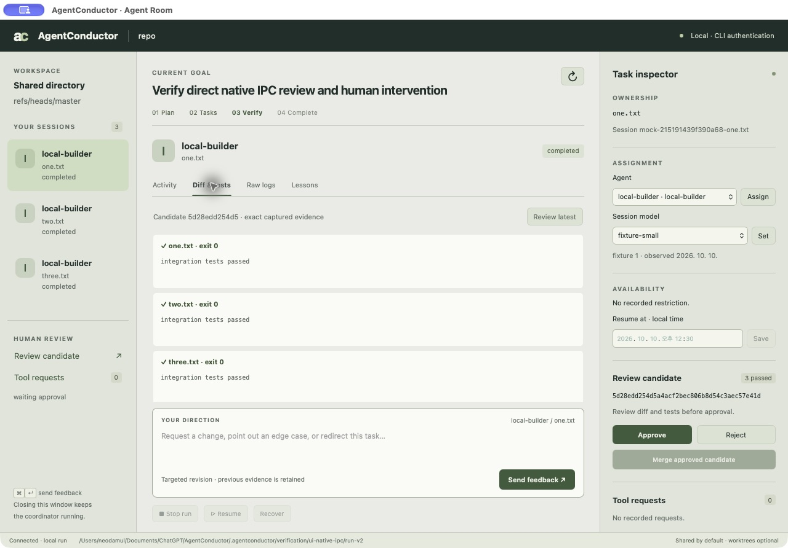
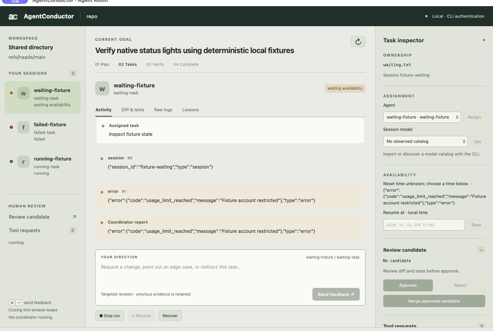

# AgentConductor User Manual

This manual is the complete reference. The [README](../README.md) is the short
introduction. Most people only need the desktop application (Part 1). The command line
(Part 2) is for automation, scripting and advanced recovery.

## Part 1 — Desktop application

### 1.1 Requirements

- macOS 11 or later (Apple silicon) or Windows (x86_64).
- Windows only: the Microsoft Edge WebView2 Runtime (preinstalled on current Windows).
- Git.
- At least one coding agent CLI installed **and already signed in**: Claude Code
  (`claude`), Codex (`codex`), OpenCode (`opencode`), or a company/custom CLI.
  AgentConductor uses that existing login. It never asks for an API key.
- A Git repository with a clean working tree to work on.
- Optional: a local agentmemory server, used
  only when you explicitly sync or import memories. Everything else works offline.

### 1.2 Install and launch

1. Download the archive for your platform and `SHA256SUMS` from GitHub Releases.
2. Verify the checksum, then extract the archive.
3. Start `agentconductor` (macOS) or `agentconductor.exe` (Windows) without arguments.
   The desktop workspace opens. The first workspace is stored in
   `~/.agentconductor/desktop`.

### 1.2a Workspaces

A workspace is a folder holding your agent registrations, goal and plans. Give it a name
in **Workspace name** above the goal and save. The title bar shows **Workspace · name ▾**;
open it to see every registered workspace by name (the current one is checked), **Remove**
an entry from the list (its folder is kept), **New workspace…** (asks only for a name and
creates the folder under `~/.agentconductor/workspaces/`) or **Open existing workspace…**
(lists every workspace saved in `~/.agentconductor`, including ones you removed from
the menu).
Choosing a workspace reloads the window on it; unsaved edits are confirmed first. A
workspace already open in another window, a running planning job, or an open run view
prevents switching, and the reason is shown.

Each package includes license notices, an SBOM and the binary's own checksum.
The window talks to the built-in Rust engine directly through native messages. There is
no local web server, port, browser session, Node runtime or cloud service. SQLite data,
logs and artifacts stay on your machine.

### 1.2b Share settings with your team (export/import)

**Workspace ▾ → Export settings…** writes `agentconductor.workspace.json` into a folder you
choose — normally your repository — so you can commit it. It contains the workspace name,
planning coordinator, worktree option, agents (executable, arguments, capability, sessions,
quota group, fallback) and role rules. It never contains private environment values, model
lists, your absolute repository path (stored as `.` when exported into the repository),
goals, plans or runs.

Teammates choose **Import settings…** and select the repository folder. A preview shows
every agent's executable, arguments and capability plus warnings; local agents that are not
in the file are removed. External-sandbox and read-only capabilities are imported as **Not
verified** unless you tick *I verified … on this machine*. Your environment values and model
lists for agents with the same ID are kept, and the repository is set to that folder.

### 1.3 Register agents

The left column lists registered agents. Use **+ Add** to choose a provider template
(Claude, Codex, OpenCode) or **Custom** for any other CLI. Each agent has:

- **Executable and arguments** — prefilled from the template; review before saving.
- **Permission mode** — Codex uses its native workspace sandbox. Claude can use the
  guarded `native_callback` mode (every tool request is shown to you). OpenCode and custom
  CLIs need an operator-verified external sandbox or a read-only configuration;
  unrestricted profiles are rejected.
- **Sessions** — up to three concurrent sessions per agent (`max_sessions`).
- **Quota group** — agents that share one subscription/account share a group, so a usage
  limit pauses all of them together. The default group is the executable.
- **Fallback** — optional agent that takes over when this account is limited (§1.8).
- **Models** — the list is fetched automatically once when you add a built-in
  agent and **Models** refreshes it, using the existing login without a generation prompt. Available models depend on your account.

Provider agents show the installed application's icon; custom agents show a letter.

### 1.4 Plan: describe the goal

Type the goal first (Korean and other IME input is supported). Below it, **Workspace
settings** holds the **Planning coordinator**, the **Repository** with **Browse…** (a
system folder dialog; typing a path also works) and **Isolate tasks in Git worktrees**
(shared directory is the default). A workspace can be saved without a repository; the
plan buttons need one. **Generate plan** asks the coordinator to read a
temporary snapshot of the repository and propose one to twelve scoped tasks (the smallest number that keeps owned paths
disjoint). The
coordinator runs read-only on a copy, so it cannot change your repository. While it works, **Review the plan**
shows "Planning with <coordinator>… m:ss elapsed"; planning usually takes about a minute.
When it finishes a *Plan ready* notice appears and the window scrolls to the plan; if it
fails, the same place shows the exit status and the log folder. **Write plan
manually** skips the coordinator entirely: it creates three empty tasks (add or remove tasks while reviewing) assigned to your
first agent, launches nothing and contacts no LLM. Fill in every task (the test command is a
JSON array such as `["npm","test"]`), **Save plan edits**, then approve. An unfilled or
overlapping plan cannot be approved, and approval is refused if the repository changed after
the form was created. **Save
workspace** keeps your inputs; **Discard changes** leaves without saving.

### 1.4a Agent roles (step 2)

The workspace screen is organised as **1. Workspace settings**, **2. Agent roles** and
**3. Review the plan**. In *Agent roles* choose, for each role, an agent and an optional
alternate, each with an optional **model** (from the agent's queried catalog — press
**Models** on the agent first; otherwise the CLI default is used): Verification, Development, Documentation, Knowledge assetization and Testing
(Planning is the planning coordinator). **Suggest defaults** fills Claude for verification,
Codex for development, documentation and knowledge, and OpenCode or a custom/company CLI for
testing, based on what you registered. Save the workspace. The coordinator must give every
task one of these roles and an agent listed for it; otherwise planning fails and names the
task. Each task in the plan shows its role. You can still change an agent while reviewing.
Final approval and merge always remain yours.

### 1.4b Read an existing plan document

If the project already has a plan (any Markdown, for example one written by Claude or Codex
or a checklist), press **Read plan…** and choose the file (up to 64 KiB). The coordinator
reads it together with a read-only copy of the repository and turns the unfinished items
into tasks that follow your agent roles; items marked done are skipped. If the goal is
empty, the document's first heading becomes the goal. Review, edit and approve as usual.

### 1.5 Review and approve the plan

Each proposed task shows its agent, instructions, owned paths, dependencies and test command.
Instructions are written as *Goal / Inputs / Steps / Expected output / Done when* sections in
the language of your goal; the box grows as you edit.
Edit anything — including which agent does which task — then **Save plan edits** and
**Approve plan & run**. Execution starts
only after your approval, which is bound to the exact plan digest. Owned paths must not
overlap. A task waits until the tasks it depends on are completed.

### 1.6 Task: watch the Agent Room



The workflow strip shows **Plan → Tasks → Verify → Complete**. Sessions on the left use
lights: green for running/completed, yellow for waiting/stopped, red for failed/blocked;
running lights pulse (steady with reduced motion). Text labels keep the exact state.



Select a task to see **Activity**, **Diff & tests**, **Raw logs** and **Lessons**.
From the task inspector you can:

- send targeted feedback (**Send feedback**, ⌘/Ctrl + Enter) — previous evidence is
  retained and dependent tasks are re-verified;
- reassign the task to another agent, or choose another observed model;
- set a **Resume at** time for a limited session;
- **Stop run**, **Resume** and **Recover**.

**Brief team** shows a read-only snapshot of every session: assigned work, latest
activity, report freshness, process presence, restrictions and next actions.
Closing the window does not stop a running coordinator; use **Stop run**.

### 1.7 Tool requests

With a guarded Claude worker, each tool call (for example a shell command or file edit)
appears under **Tool requests** with its exact input and context. **Review & allow** or
**Deny** while the worker waits (default 600 seconds, `AGENTCONDUCTOR_TOOL_DECISION_WAIT_SECS`;
`0` restores stop-and-resume). Approvals bind the task, session, plan, workspace and exact
input, expire within 900 seconds and are consumed once. Tool approval never approves a
merge.

### 1.8 Usage limits, roles and redistribution

When a CLI reports a temporary usage limit (hourly, weekly or any other window), the
engine records the reset time the provider reported and marks every waiting session in
the same quota group as limited. Then:

1. **Fallback configured** — work moves to the fallback agent, which must use a different
   quota group (for example a company CLI). Active attempts exit first; scoped partial
   files and logs are kept; the fallback starts a new session with a handoff. Cycles and
   unobserved models are rejected. If the fallback is also limited, the work waits.
2. **No fallback, known reset time** — the session is scheduled for that time and resumes
   when due (**Resume**, or `agentconductor watch` while it runs). Up to three automatic
   retries; a manual schedule renews them.
3. **Unknown reset time** — the session waits for you to set **Resume at**, reassign it
   or change its model.

Authentication and configuration errors are never retried automatically. Ordinary
failures and your own stops do not trigger fallback. Verification and your merge approval
are always required again after a transfer.

**Account capacity** shows remaining percentage, reset time, source and freshness for an
account. Codex quota can be refreshed through its authenticated CLI. Claude quota is
collected automatically from `rate_limit_event` metadata in tasks launched by this app:
reported utilization of 0.27 appears as **73% remaining**, with the provider's reset time.
**Check observed quota** rechecks retained metadata without starting Claude or consuming
additional tokens. It does not make an independent account request. Windows with missing
utilization show **Unavailable**; observations older than five minutes or past their reset
show stale capacity until another event arrives. Claude may omit these events or their
utilization, depending on CLI version, account and usage state, so a percentage is not
guaranteed. Interactive Claude `/usage` remains available for checking your plan directly.
Token counts and cost estimates are not account balance.

### 1.9 Verify and complete

**Diff & tests** captures the integrated candidate: the combined diff and every task's
test result. **Approve** binds the exact candidate commit, base branch, diff and passing
test evidence; any change revokes it. **Merge approved candidate** is a second, separate
confirmation. A reviewer coordinator can propose up to three rounds of quality feedback
but can never approve a merge.

### 1.10 Lessons and memory

A reviewed lesson records context, failure, cause, response and evidence with source file
hashes. Accepted lessons are stored in SQLite and mirrored to wiki pages in the run.
Before reuse, source hashes are checked; changed sources make a lesson stale. Fresh lessons
are given to the matching task (up to 8 KiB) and grant no permissions. agentmemory is
optional: `memory-sync` publishes reviewed summaries and `memory-import` reads cooperative
checkpoint reports from a local agentmemory server only when you ask; `memory-discover`
finds them without memory IDs.

## Part 2 — Command-line reference

Run directories must be outside the repository, and the repository must start clean.
`RUN` is a run directory, `TASK` a task ID, `AGENT` a registered agent ID.

### 2.1 Workspace and agents

| Command | Purpose |
|---|---|
| `agentconductor` | Open the default desktop workspace. |
| `agentconductor ui-new <workspace-dir>` | Open a desktop workspace in a chosen directory. |
| `agentconductor ui <run-dir>` | Open the Agent Room for an existing run (one window per run). |
| `agentconductor profiles <profiles.json>` | Write provider profile templates to review. |
| `agentconductor models-discover <profiles.json> AGENT <new-dir>` | Query a CLI's model catalog without a generation prompt. |
| `agentconductor catalog-import <profiles.json> AGENT <catalog.json>` | Import an operator-observed catalog when a CLI cannot list models. |

### 2.2 Plan and run

| Command | Purpose |
|---|---|
| `agentconductor plan <profiles.json> <coordinator> <repo> <new-plan-dir> "<goal>"` | Ask a read-only coordinator for a plan (1–12 tasks); `[roles.json]` adds role rules, `--from plan.md` converts an existing plan document. |
| `agentconductor validate <plan.json>` | Validate a plan and print its digest. |
| `agentconductor run <plan.json> <repo> <new-run-dir> <digest>` | Execute the approved plan. |
| `agentconductor status RUN` | Show run and task state. |
| `agentconductor logs RUN TASK` | Show a task's logs. |
| `agentconductor progress RUN TASK` | Show recent normalized events of the current attempt. |
| `agentconductor diff RUN` | Capture the integrated candidate diff and tests. |
| `agentconductor approve RUN <candidate-sha>` | Approve the exact candidate. |
| `agentconductor reject RUN "<reason>"` | Reject the candidate. |
| `agentconductor merge RUN` | Merge the approved candidate. |

A plan file can also be written by hand: a `tasks` array where each task has `id`,
`agent`, `prompt`, `paths`, `depends_on` and `test_command`, plus the agent profiles and
optional `"workspace_mode": "worktree"`. Validate it to obtain the digest.

### 2.3 Sessions, limits and recovery

| Command | Purpose |
|---|---|
| `agentconductor sessions RUN` | List task sessions. |
| `agentconductor briefing RUN` | Read-only team briefing. |
| `agentconductor quota-refresh RUN AGENT` | Refresh an account's quota (Codex). |
| `agentconductor schedule RUN TASK <YYYY-MM-DDTHH:MM:SS+HH:MM>` | Schedule a limited session. |
| `agentconductor reassign RUN TASK AGENT [model]` | Move a task to another agent. |
| `agentconductor session-model RUN TASK <model>` | Change a session's observed model. |
| `agentconductor revise RUN TASK "<feedback>"` | Targeted feedback (up to 16 KiB). |
| `agentconductor stop RUN "<reason>"` | Stop processes, keeping logs and partial files. |
| `agentconductor resume RUN` | Explicitly resume a stopped run. |
| `agentconductor resume-due RUN` | Resume scheduled work that is due. |
| `agentconductor watch RUN` | Keep resuming due work while running. |
| `agentconductor recover RUN` | After a crash, confirm processes are gone and mark the run stopped. |

A cooperative custom CLI that completes a `handoff` request continues automatically on its
reviewed fallback agent once its processes have exited; without a fallback the task stops
and waits for you. A `pause` always stops.

Fallback in a profile:

```json
"quota_group": "company-codex-account",
"fallback": { "agent": "company-cli", "model": null }
```

### 2.4 Tool requests

| Command | Purpose |
|---|---|
| `agentconductor tool-requests RUN` | List pending tool requests. |
| `agentconductor tool-approve RUN <request-sha256> [seconds]` | Allow one exact request. |
| `agentconductor tool-reject RUN <request-sha256>` | Deny it. |
| `agentconductor tool-refresh RUN <request-sha256>` | Create a new pending request (never renews approval). |

### 2.5 Review

| Command | Purpose |
|---|---|
| `agentconductor review RUN <coordinator>` | Request a quality-review proposal and its SHA-256. |
| `agentconductor apply-review RUN <proposal-sha256>` | Apply an inspected proposal. |
| `agentconductor review-apply RUN <coordinator>` | Review and apply immediately. |

### 2.6 Knowledge and memory

| Command | Purpose |
|---|---|
| `agentconductor knowledge-digest <lesson.json>` | Print a lesson draft's digest. |
| `agentconductor knowledge-accept RUN <lesson.json> <digest>` | Promote a reviewed lesson. |
| `agentconductor knowledge-status RUN` | Show lessons and their freshness. |
| `agentconductor recall RUN "<query>"` | Search local lessons offline. |
| `agentconductor memory-sync RUN <port>` | Publish reviewed summaries to local agentmemory. |
| `agentconductor memory-publish <port> <envelope.json>` | Publish a checkpoint envelope. |
| `agentconductor memory-read <port> <memory-id>` | Read one memory by exact ID. |
| `agentconductor memory-import RUN <port> <memory-id>` | Import a validated checkpoint observation. |
| `agentconductor memory-discover RUN <port>` | Find and import new checkpoint reports for every cooperative task without memory IDs. |

A lesson draft is JSON with `task`, `context`, `failure`, `cause`, `response`,
`evidence`, `confidence` (0–1), `revalidate` and `sources` (repository-relative `path`
and current `sha256`).

### 2.7 Cooperative checkpoints (custom CLIs)

A custom CLI that polls safely can register `"cooperative": "checkpoint_v1"` with exactly
one `{session_id}` argument. The engine supplies `AC_CHECKPOINT_RUN_DIR`,
`AC_CHECKPOINT_ADDRESS_FILE` and `AC_CHECKPOINT_EXECUTABLE`. Full contract:
[cooperative checkpoints](https://github.com/neodamul/AgentConductor/blob/main/docs/11-cooperative-checkpoints.md).

| Command | Purpose |
|---|---|
| `agentconductor checkpoint-issue RUN <issue.json>` | Address a pause/handoff request to a worker. |
| `agentconductor checkpoint-poll RUN <address.json>` | Worker polls for requests. |
| `agentconductor checkpoint-ack RUN <ack.json>` | Worker acknowledges a request. |
| `agentconductor checkpoint-report RUN <progress.json>` | Worker reports bounded progress. |

### 2.8 Diagnostics

| Command | Purpose |
|---|---|
| `agentconductor normalize <claude\|codex\|opencode\|custom> <stdout.jsonl>` | Normalize a CLI's JSONL output into events. |

## Part 3 — Supported CLI versions

Versions below were exercised live with existing subscription logins. Other versions may
work; output contracts are pinned per provider and unknown output stops the worker safely.

| CLI | Verified version | Live evidence | Not yet verified live |
|---|---|---|---|
| Claude Code | 2.1.287 (2026-10-11) | Sessions and resume, metadata-only control, three guarded workers through approve and merge, scope-escape denial and human rejection | Independent headless quota refresh; stream utilization may be absent |
| Codex | 0.162.0 | Session start and exact resume, two concurrent sessions, quota refresh | 0.162.1 re-run blocked by the account usage limit until 2026-10-16; its limit message is recognized |
| OpenCode | 2.0.25 (2026-10-11) | Task-file turn and exact session resume with a free hosted model through the product's own argv builder | Paid provider models |
| Custom / company CLI | — | Compiled and Python checkpoint fixtures, packaged smoke workers | A real company CLI |
| agentmemory server | 0.9.29 | Publish, exact read, import and scoped discovery against the local daemon | — |

## Part 4 — Troubleshooting

- **"coordinator requires read-only capabilities"** — choose a Codex or guarded Claude
  coordinator, or a custom CLI; planning always runs on a temporary snapshot.
- **"Agent Room is already open"** — close the other window for that run first.
- **"a clean repository baseline is required"** — your repository has uncommitted or
  untracked changes. Planning starts from one commit so the team's changes stay separate
  from your own work and nothing uncommitted is overwritten. The window lists the changed
  files and asks: **Commit and continue** records them all in one commit on the current
  branch and continues; **Stop** changes nothing (commit or stash yourself, then retry).
- **Only `.DS_Store` (or `Thumbs.db`, `desktop.ini`, `._*`) files are listed** — these are
  created by the operating system. Choose **Ignore and continue**: they are added to this
  repository's local exclude list (`.git/info/exclude`), nothing is committed and your
  `.gitignore` stays unchanged. To ignore them in every repository once, add `.DS_Store` to
  `~/.gitignore_global` and run `git config --global core.excludesFile ~/.gitignore_global`.
  If other files remain, the dialog then shows only those.
- **Session waiting with no reset time** — set **Resume at**, reassign or change model.
- **Windows window does not open** — install the Microsoft Edge WebView2 Runtime.
