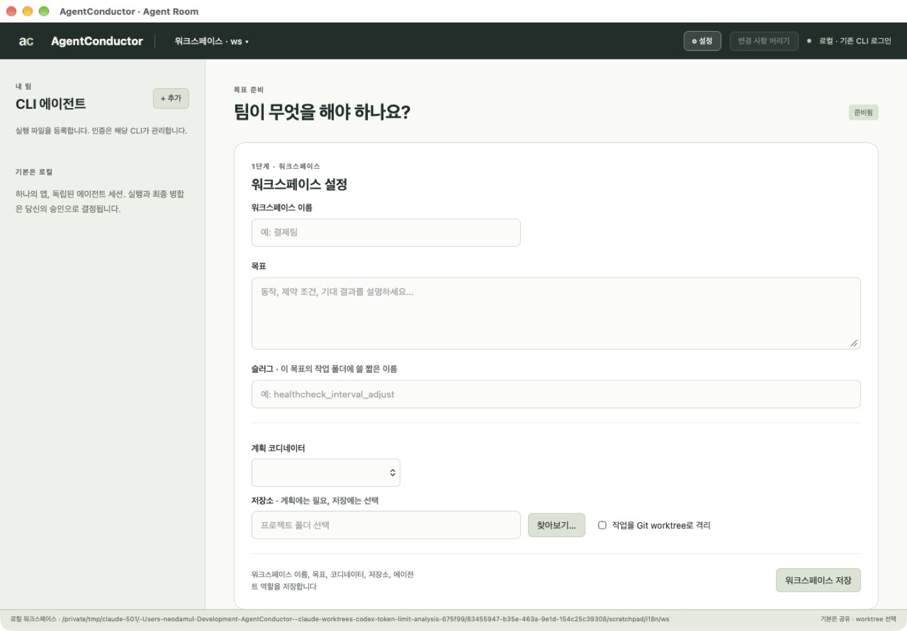

# AgentConductor User Manual

This manual is the complete reference. The [README](../README.md) is the short
introduction. Most people only need the desktop application (Part 1). The command line
(Part 2) is for automation, scripting and advanced recovery.

## Part 1 — Desktop application

### 1.1 Requirements

- macOS 11 or later (Apple silicon) or Windows (x86_64).
- Windows only: the Microsoft Edge WebView2 Runtime (preinstalled on current Windows).
- Git.
- At least one coding agent CLI installed **and already signed in**: Claude Code
  (`claude`), Codex (`codex`), OpenCode (`opencode`), or a company/custom CLI.
  AgentConductor uses that existing login. It never asks for an API key.
- An existing project folder. A Git repository is optional; Git itself is used for private change history.
- Optional: a local agentmemory server, used
  only when you explicitly sync or import memories. Everything else works offline.

Stable release numbering starts at **0.1.0**; the next version is **0.1.1**. Stable
GitHub releases are not marked as pre-releases. Earlier preview entries remain historical.

### 1.2 Install and launch

1. Download the archive for your platform and `SHA256SUMS` from GitHub Releases.
2. Verify the checksum, then extract the archive.
3. Open `AgentConductor.app` (macOS), or start the standalone `agentconductor` /
   `agentconductor.exe` without arguments. The AC mark identifies the application.
   The desktop workspace opens. The first workspace is stored in
   `~/.agentconductor/desktop`.

### 1.2a Workspaces

A workspace is a folder holding your agent registrations, goal and plans. Give it a name
in **Workspace name** above the goal and save. The title bar shows **Workspace · name ▾**;
open it to see every registered workspace by name (the current one is checked), **Remove**
an entry from the list (its folder is kept), **New workspace…** (asks only for a name and
creates the folder under `~/.agentconductor/workspaces/`) or **Open existing workspace…**
(lists every workspace saved in `~/.agentconductor`, including ones you removed from
the menu).
Choosing a workspace reloads the window on it; unsaved edits are confirmed first. A
workspace already open in another window, a running planning job, or an open run view
prevents switching, and the reason is shown.

Each package includes license notices, an SBOM and the binary's own checksum.
The window talks to the built-in Rust engine directly through native messages. There is
no local web server, port, browser session, Node runtime or cloud service. SQLite data,
logs and artifacts stay on your machine.

### 1.2c Interface language (Settings)

Choose the ⚙ (Settings) button in the title bar, pick **Interface language** — English (default) or 한국어 — and save. The window switches at once without losing unsaved edits, and the choice applies to every workspace on this computer (`~/.agentconductor/preferences.json`). Goals, task instructions, logs and agent output are never translated. All files and pages use UTF-8.



### 1.2e Agent tools guide (Settings)

**Settings → Agent tools guide…** lists optional tools that help Claude Code and Codex work together. AgentConductor does not install, run or require them; copy each command into a terminal. Commands starting with `/` run inside Claude Code. graphify and cocoindex-code need [uv](https://docs.astral.sh/uv/) (`brew install uv` on macOS, `winget install astral-sh.uv` on Windows).

- **agentmemory** — shared memory and signals between agents; needs Node.js 20+ (WSL2 or Docker on Windows). Start the server and keep it running: `npx -y @agentmemory/agentmemory@latest`. Claude Code: `/plugin marketplace add rohitg00/agentmemory`, then `/plugin install agentmemory`. Codex: `codex plugin marketplace add rohitg00/agentmemory`, then `codex plugin add agentmemory@agentmemory`.
- **ponytail** — coding rules for the smallest complete change. Claude Code: `/plugin marketplace add DietrichGebert/ponytail`, then `/plugin install ponytail@ponytail`. Codex: `codex plugin marketplace add DietrichGebert/ponytail`, then `codex plugin add ponytail@ponytail`; trust its hooks in Codex `/hooks` and start a new session.
- **rtk** — compresses shell output to save tokens. Install with `brew install rtk` (macOS) or `winget install rtk-ai.rtk` (Windows). Claude Code: `rtk init -g`. Codex: `rtk init -g --codex`. Check with `rtk gain`.
- **graphify** — code knowledge graph. `uv tool install graphifyy`; Claude Code: `graphify install`; Codex: `graphify install --platform codex`; in the project: `graphify update .`.
- **cocoindex-code** — semantic code search. `uv tool install --upgrade 'cocoindex-code[full]'`; Claude Code: `/plugin marketplace add cocoindex-io/cocoindex-code`, then `/plugin install cocoindex-code@cocoindex-code`; Codex: `codex mcp add cocoindex-code -- ccc mcp`; in the project: `ccc init`, then `ccc index`.

Each tool is a third-party project; review its repository before installing.

### 1.2d Messenger notifications (Slack or company messenger)

Workspace menu → **Messenger…**:

1. Tick **Send notifications for this workspace**.
2. Choose **Slack (Incoming Webhook)** — create one in Slack under *Apps → Incoming Webhooks* for the channel — or **Company messenger (webhook)** for any messenger that accepts an incoming webhook with a JSON body.
3. Paste the **Webhook URL** (`https://` only). It is stored only on this computer (`~/.agentconductor/messenger-secrets.json`, owner-only) and is never exported or shown again; leave the field empty later to keep it.
4. Choose when to notify: plan ready, candidate ready for review, tool request needs a decision, waiting for account availability, run completed / failed / stopped / blocked.
5. Company messenger only: edit **Message body · JSON** with the placeholders `{{text}}`, `{{event}}`, `{{state}}`, `{{workspace}}`, `{{goal}}` (values are JSON-escaped; the result must be a JSON object).
6. The goal text is sent only if **Include the goal text in messages** is ticked; otherwise messages contain the workspace name, the event and task counts.
7. **Send test message**, then **Save**.

Messages follow the interface language. Each state change is sent once; a messenger that is down never slows or fails a run (problems are written to `<run>.messenger.log`). Exported workspace settings include these choices but not the URL — each teammate enters their own. 

**Answer tool requests from the messenger (phase 2).** Tick **Let listed approvers reply allow or deny** and list **Approvers** (Slack user IDs such as `U0123ABCD`, or the user names your company relay reports).

- *Slack:* enter the **Slack channel ID** (`C…`) and a **Slack bot token** (`xoxb-…`) of an app with the `channels:history` scope that is a member of the channel. When an agent waits for a tool decision, the channel gets "Reply `allow 3FA9C21B` or `deny 3FA9C21B`"; a listed approver replies with exactly that, and within about 15 seconds the decision is applied as if **Allow**/**Deny** were pressed in the Agent Room, and a confirmation is posted.
- *Company messenger:* enter the **Relay URL** and **Relay secret** of a company-hosted relay that returns `{"decisions":[{"code","decision":"allow|deny","user","ts","signature"}]}` with `signature = hex(HMAC-SHA256(secret, "code|decision|user|ts"))`; AgentConductor asks with `?since=<last ts>`.

Only tool requests of a run that is still running can be answered; plan approval and merge stay in the app. Replies from people who are not approvers, unknown or expired codes and repeats are ignored and written to `<run>.messenger.log`; every remote decision is recorded with the approver ID. The bot token, relay URL and secret are stored like the webhook URL — on this computer only. The app checks the messenger only while a request is waiting (every 15 s).

### 1.2b Share settings with your team (export/import)

**Workspace ▾ → Export settings…** writes `agentconductor.workspace.json` into a folder you
choose — normally your repository — so you can commit it. It contains the workspace name,
planning coordinator, worktree option, agents (executable, arguments, capability, sessions,
quota group, fallback, refresh interval) and role rules. Profile environment values and
observed model catalogs are omitted; the repository path is `.` when exported into it.
Named goal slugs include their goals, derived progress and one store-only ZIP archive per
slug. Review the archive contents before sharing work context with teammates.

Teammates choose **Import settings…** and select the repository folder. A preview shows
every agent's executable, arguments and capability plus warnings; local agents that are not
in the file are removed. External-sandbox and read-only capabilities are imported as **Not
verified** unless you tick *I verified … on this machine*. Your environment values and model
lists for agents with the same ID are kept, and the repository is set to that folder.
Listed slug archives are staged and verified before they are applied.


### 1.3 Register agents

New workspaces start with no registered agents. The left column lists agents you have
added; built-in provider templates remain available. Use **+ Add** to choose a provider template
(Claude, Codex, OpenCode) or **Custom** for any other CLI. Each agent has:

- **Executable and arguments** — installed CLI paths are found automatically. A custom
  path is retained. If lookup fails, use **Browse…** in Edit to select an executable;
  picking a file fills the field without executing it. Arguments remain a JSON array.
- **Quota refresh · minutes** — each agent has its own interval, default **5**, with
  whole-minute values from **1** to **60**. Save with **Use profile**. Changing only this
  interval preserves an already reviewed plan; changing execution settings needs review.
- **Permission mode** — Codex uses its native workspace sandbox. Claude can use the
  guarded `native_callback` mode (every tool request is shown to you). OpenCode and custom
  CLIs need an operator-verified external sandbox or a read-only configuration;
  unrestricted profiles are rejected.
- **Sessions** — up to three concurrent sessions per agent (`max_sessions`).
- **Quota group** — agents that share one subscription/account share a group, so a usage
  limit pauses all of them together. The default group is the executable.
- **Fallback** — optional agent that takes over when this account is limited (§1.8). **Alternate agent's model** is the model *that* agent uses then (not this agent's model); choosing the alternate agent loads its model list automatically.
- **Models** — the list is fetched automatically once when you add a built-in
  agent and **Models** refreshes it, using the existing login without a generation prompt. Available models depend on your account.

**Provider** is the first field. Choosing another provider rewrites the whole profile at once: Agent ID (for example `codex`, or `codex-2` when taken), the located executable path, arguments, input, permission, sessions and refresh minutes; models of the previous CLI are cleared, so press **Models** after saving. A renamed agent keeps its place as coordinator, in role rules and as other agents' fallback.

Provider agents show the installed application's icon; custom agents show a letter.
Agent cards provide a pencil **Edit** button, **Models** with a reload icon, and a trash
icon to remove the registration. Enabled buttons show a hand cursor. Removing a
registration does not uninstall its CLI or sign it out.

The workspace follows three sections: **STEP 1 · WORKSPACE** / **Workspace settings**,
**STEP 2 · TEAM** / **Agent roles**, and **STEP 3 · YOUR EXECUTION DECISION** /
**Review the plan**. Configure and review these sections before approving execution.


### 1.4 Plan: describe the goal

Type the goal first (Korean and other IME input is supported). Below it, **Workspace
settings** holds the **Planning coordinator**, the **Repository** with **Browse…** (a
system folder dialog; typing a path also works) and **Isolate tasks in Git worktrees**
(shared directory is the default). A workspace can be saved without a repository; the
plan buttons need one. **Generate plan** asks the coordinator to read a
temporary snapshot of the repository and propose one to twelve scoped tasks (the smallest number that keeps owned paths
disjoint). The
coordinator runs read-only on a copy, so it cannot change your repository. While it works, **Review the plan**
shows "Planning with <coordinator>… m:ss elapsed"; planning usually takes about a minute.
When it finishes a *Plan ready* notice appears and the window scrolls to the plan; if it
fails, the same place shows the exit status and the log folder. **Write plan
manually** skips the coordinator entirely: it creates three empty tasks (add or remove tasks while reviewing) assigned to your
first agent, launches nothing and contacts no LLM. Fill in every task (the test command is a
JSON array such as `["npm","test"]`), **Save plan edits**, then approve. An unfilled or
overlapping plan cannot be approved, and approval is refused if the repository changed after
the form was created. **Save
workspace** keeps your inputs; **Discard changes** leaves without saving.

### 1.4a Agent roles (step 2)

The workspace screen is organised as **1. Workspace settings**, **2. Agent roles** and
**3. Review the plan**. In *Agent roles* choose, for each role, an agent and an optional
alternate, each with an optional **model** (from the agent's queried catalog — press
**Models** on the agent first; otherwise the CLI default is used): Verification, Development, Documentation, Knowledge assetization and Testing
(Planning is the planning coordinator). **Suggest defaults** fills Claude for verification,
Codex for development, documentation and knowledge, and OpenCode or a custom/company CLI for
testing, based on what you registered. Save the workspace. The coordinator must give every
task one of these roles and an agent listed for it; otherwise planning fails and names the
task. Each task in the plan shows its role. You can still change an agent while reviewing.
Final approval and merge always remain yours.

### 1.4c Goals, slugs and phases

Every goal becomes a **slug** — a short readable folder name chosen automatically from the
goal, such as `healthcheck_interval_adjust`. A goal in another language, such as Korean, starts
as `goal_<yyyymmdd>` and is renamed to the English name the coordinator proposes with the plan
(`사다리 게임을 만들자` → `ladder_game`); a name already in use gets `_2`, `_3`… There is nothing to type.
Goals accumulate: a new goal adds a slug, earlier ones keep their history. Each slug has a
work folder `plan/ phase/ task/ verification/ completed/` in
`<repository>/.agentconductor/<slug>/` (kept out of Git status) or, without a repository,
in the workspace folder.

**Generate plan** asks the coordinator for an analysis and ordered phases. Only the first
phase is offered for approval. Its task files move to `verification/` when the run's tests
pass and to `completed/` after you merge. **Goals & progress** at the top shows every slug
with its stage and per-phase counts, and warns if the folders were changed by hand. When a
phase is completed, **Plan next phase** prepares the next one from the saved plan — no
coordinator runs. A coordinator that ignores phases still works: its tasks become one phase.

**Workspace ▾ → Plan rules…** edits the rules the coordinator follows: the global rules file
(`~/.agentconductor/plan-rules.md`, every workspace on this machine) or rules for this
workspace only (saved and exported with it).

### 1.4b Read an existing plan document

If the project already has a plan (any Markdown, for example one written by Claude or Codex
or a checklist), press **Read plan…** and choose the file (up to 64 KiB). The coordinator
reads it together with a read-only copy of the repository and turns the unfinished items
into tasks that follow your agent roles; items marked done are skipped. If the goal is
empty, the document's first heading becomes the goal. Review, edit and approve as usual.

### 1.5 Review and approve the plan

Each proposed task shows its agent, instructions, owned paths, dependencies and test command.
Instructions are written as *Goal / Inputs / Steps / Expected output / Done when* sections in
the language of your goal; the box grows as you edit.
Edit anything — including which agent does which task — then **Save plan edits** and
**Approve plan & run**. Execution starts
only after your approval, which is bound to the exact plan digest. Owned paths must not
overlap. A task waits until the tasks it depends on are completed.

### 1.6 Task: watch the Agent Room


The workflow strip shows **Plan → Tasks → Verify → Complete**. Sessions on the left use
lights: green for running/completed, yellow for waiting/stopped, red for failed/blocked;
running lights pulse (steady with reduced motion). Text labels keep the exact state.


Select a task to see **Activity**, **Diff & tests**, **Raw logs** and **Lessons**.
From the task inspector you can:

- send targeted feedback (**Send feedback**, ⌘/Ctrl + Enter) — previous evidence is
  retained and dependent tasks are re-verified;
- reassign the task to another agent, or choose another observed model;
- set a **Resume at** time for a limited session;
- **Stop run**, **Resume** and **Recover**.

**Brief team** shows a read-only snapshot of every session: assigned work, latest
activity, report freshness, process presence, restrictions and next actions.
Closing the window does not stop a running coordinator; use **Stop run**.

### 1.7 Tool requests

With a guarded Claude worker, each tool call (for example a shell command or file edit)
appears under **Tool requests** with its exact input and context. **Review & allow** or
**Deny** while the worker waits (default 600 seconds, `AGENTCONDUCTOR_TOOL_DECISION_WAIT_SECS`;
`0` restores stop-and-resume). Approvals bind the task, session, plan, workspace and exact
input, expire within 900 seconds and are consumed once. Tool approval never approves a
merge.

### 1.8 Usage limits, roles and redistribution

When a CLI reports a temporary usage limit (hourly, weekly or any other window), the
engine records the reset time the provider reported and marks every waiting session in
the same quota group as limited. Then:

1. **Fallback configured** — work moves to the fallback agent, which must use a different
   quota group (for example a company CLI). Active attempts exit first; scoped partial
   files and logs are kept; the fallback starts a new session with a handoff. Cycles and
   unobserved models are rejected. If the fallback is also limited, the work waits.
2. **No fallback, known reset time** — the session is scheduled for that time and resumes
   when due (**Resume**, or `agentconductor watch` while it runs). Up to three automatic
   retries; a manual schedule renews them.
3. **Unknown reset time** — the session waits for you to set **Resume at**, reassign it
   or change its model.

Authentication and configuration errors are never retried automatically. Ordinary
failures and your own stops do not trigger fallback. Verification and your merge approval
are always required again after a transfer.

The left agent lists show each paid agent's remaining capacity on one compact line,
such as `64%/100% ↻`. Rolling windows are ordered by their reported period, such as **5h / Weekly** or **Daily / Weekly**. Enterprise budget metadata takes priority and is shown as a percentage: a reported allocation of `1000` and usage of `360` shows `64%/100%`. Hover shows the raw amounts, scope, reset, source and observation time. Codex CLI individual limits and credit balances are distinct: a balance of `730` with no total allocation has no percentage and shows `—` (the tooltip keeps `730/—`), and only an explicit unlimited credit flag shows `∞`. A weekly window is never relabeled as total company allocation. Missing company allocation is not inferred from credits, token counts or cost estimates.
The numeric badge and refresh icon have separate backgrounds with a small gap.
When a window is exhausted (0 %), the badge also shows when capacity returns, for example `0%/40% · 18:39` (a date is added when it is not today; `reset unknown` when the provider gave no time). The tooltip lists every window's reset time.
On Windows, Claude capacity needs the Claude CLI to have finished its first-run setup (theme and sign-in); otherwise the tooltip says so — run `claude` once in a terminal, then refresh. `—` means unavailable and **Stale** means an old observation. Each agent has its own
**↻** refresh button and a default five-minute automatic cadence while the visible UI coordinator is
idle. Edit the interval separately for each agent. Refresh runs in the background
without loading or completion messages and without waiting on the UI thread. Queries serialize
and defer during active coordinator/worker operations; metadata
refresh does not change execution scopes, plan consent or merge approval. Unsupported
providers have a disabled refresh icon. Agent actions use a pencil for **Edit**, **Models**
with a reload icon, and a trash icon for **Remove**.

A workspace can collect capacity before any execution run exists. Codex uses authenticated
`app-server` account metadata. On macOS, Claude uses its local interactive `/usage` command
in screen-reader mode with tools and hooks disabled; this requests account metadata without
an LLM prompt or API-key registration. A project trust request stops collection until you
approve it directly; the app never accepts it automatically. This terminal adapter is
verified with Claude 2.1.287; unsupported versions/formats report unavailable. Windows uses a bounded ConPTY adapter with native/batch fixtures. Actual Enterprise account formats and company policies require operator acceptance; unrecognized Claude `/usage` output remains unavailable until its real format is supplied.

**Account capacity** retains detailed windows, source and freshness. Observations older
than five minutes or past a reported reset suppress their remaining percentage. Missing
utilization remains unknown. Rooms reuse workspace quota only when their exact run is
bound to that workspace and the current CLI profile matches. Token counts, context-window
capacity and cost estimates are not subscription balance.

### 1.9 Verify and complete

**Diff & tests** captures the integrated candidate: the combined diff and every task's
test result. **Approve** binds the exact candidate commit, base branch, diff and passing
test evidence; any change revokes it. **Merge approved candidate** is a second, separate
confirmation. A reviewer coordinator can propose up to three rounds of quality feedback
but can never approve a merge.

### 1.10 Lessons and memory

A reviewed lesson records context, failure, cause, response and evidence with source file
hashes. Accepted lessons are stored in SQLite and mirrored to wiki pages in the run.
Before reuse, source hashes are checked; changed sources make a lesson stale. Fresh lessons
are given to the matching task (up to 8 KiB) and grant no permissions. agentmemory is
optional: `memory-sync` publishes reviewed summaries and `memory-import` reads cooperative
checkpoint reports from a local agentmemory server only when you ask; `memory-discover`
finds them without memory IDs.

## Part 2 — Command-line reference

Run directories must be outside the repository, and the repository must start clean.
`RUN` is a run directory, `TASK` a task ID, `AGENT` a registered agent ID.

### 2.1 Workspace and agents

| Command | Purpose |
|---|---|
| `agentconductor` | Open the default desktop workspace. |
| `agentconductor ui-new <workspace-dir>` | Open a desktop workspace in a chosen directory. |
| `agentconductor ui <run-dir>` | Open the Agent Room for an existing run (one window per run). |
| `agentconductor profiles <profiles.json>` | Write provider profile templates to review. |
| `agentconductor models-discover <profiles.json> AGENT <new-dir>` | Query a CLI's model catalog without a generation prompt. |
| `agentconductor catalog-import <profiles.json> AGENT <catalog.json>` | Import an operator-observed catalog when a CLI cannot list models. |

### 2.2 Plan and run

| Command | Purpose |
|---|---|
| `agentconductor plan <profiles.json> <coordinator> <repo> <new-plan-dir> "<goal>"` | Ask a read-only coordinator for a plan (1–12 tasks); `[roles.json]` adds role rules, `--from plan.md` converts an existing plan document; `--rules rules.md` adds plan rules; `--phases slug-dir` asks for an analysis and ordered phases and records them in a slug work tree. |
| `agentconductor validate <plan.json>` | Validate a plan and print its digest. |
| `agentconductor run <plan.json> <repo> <new-run-dir> <digest> [--phase slug-dir phase-id]` | Execute the approved plan; `--phase` moves that slug phase's tasks to verification and, after merge, to completed. |
| `agentconductor status RUN` | Show run and task state. |
| `agentconductor logs RUN TASK` | Show a task's logs. |
| `agentconductor progress RUN TASK` | Show recent normalized events of the current attempt. |
| `agentconductor diff RUN` | Capture the integrated candidate diff and tests. |
| `agentconductor approve RUN <candidate-sha>` | Approve the exact candidate. |
| `agentconductor reject RUN "<reason>"` | Reject the candidate. |
| `agentconductor merge RUN` | Merge the approved candidate. |

A plan file can also be written by hand: a `tasks` array where each task has `id`,
`agent`, `prompt`, `paths`, `depends_on` and `test_command`, plus the agent profiles and
optional `"workspace_mode": "worktree"`. Validate it to obtain the digest.

### 2.3 Sessions, limits and recovery

| Command | Purpose |
|---|---|
| `agentconductor sessions RUN` | List task sessions. |
| `agentconductor briefing RUN` | Read-only team briefing. |
| `agentconductor quota-refresh RUN AGENT` | Refresh account quota (Codex; Claude `/usage` on macOS). |
| `agentconductor schedule RUN TASK <YYYY-MM-DDTHH:MM:SS+HH:MM>` | Schedule a limited session. |
| `agentconductor reassign RUN TASK AGENT [model]` | Move a task to another agent. |
| `agentconductor session-model RUN TASK <model>` | Change a session's observed model. |
| `agentconductor revise RUN TASK "<feedback>"` | Targeted feedback (up to 16 KiB). |
| `agentconductor stop RUN "<reason>"` | Stop processes, keeping logs and partial files. |
| `agentconductor resume RUN` | Explicitly resume a stopped run. |
| `agentconductor resume-due RUN` | Resume scheduled work that is due. |
| `agentconductor watch RUN` | Keep resuming due work while running. |
| `agentconductor recover RUN` | After a crash, confirm processes are gone and mark the run stopped. |

A cooperative custom CLI that completes a `handoff` request continues automatically on its
reviewed fallback agent once its processes have exited; without a fallback the task stops
and waits for you. A `pause` always stops.

Fallback in a profile:

```json
"quota_group": "company-codex-account",
"fallback": { "agent": "company-cli", "model": null }
```

### 2.4 Tool requests

| Command | Purpose |
|---|---|
| `agentconductor tool-requests RUN` | List pending tool requests. |
| `agentconductor tool-approve RUN <request-sha256> [seconds]` | Allow one exact request. |
| `agentconductor tool-reject RUN <request-sha256>` | Deny it. |
| `agentconductor tool-refresh RUN <request-sha256>` | Create a new pending request (never renews approval). |

### 2.5 Review

| Command | Purpose |
|---|---|
| `agentconductor review RUN <coordinator>` | Request a quality-review proposal and its SHA-256. |
| `agentconductor apply-review RUN <proposal-sha256>` | Apply an inspected proposal. |
| `agentconductor review-apply RUN <coordinator>` | Review and apply immediately. |

### 2.6 Knowledge and memory

| Command | Purpose |
|---|---|
| `agentconductor knowledge-digest <lesson.json>` | Print a lesson draft's digest. |
| `agentconductor knowledge-accept RUN <lesson.json> <digest>` | Promote a reviewed lesson. |
| `agentconductor knowledge-status RUN` | Show lessons and their freshness. |
| `agentconductor recall RUN "<query>"` | Search local lessons offline. |
| `agentconductor memory-sync RUN <port>` | Publish reviewed summaries to local agentmemory. |
| `agentconductor memory-publish <port> <envelope.json>` | Publish a checkpoint envelope. |
| `agentconductor memory-read <port> <memory-id>` | Read one memory by exact ID. |
| `agentconductor memory-import RUN <port> <memory-id>` | Import a validated checkpoint observation. |
| `agentconductor memory-discover RUN <port>` | Find and import new checkpoint reports for every cooperative task without memory IDs. |

A lesson draft is JSON with `task`, `context`, `failure`, `cause`, `response`,
`evidence`, `confidence` (0–1), `revalidate` and `sources` (repository-relative `path`
and current `sha256`).

### 2.7 Cooperative checkpoints (custom CLIs)

A custom CLI that polls safely can register `"cooperative": "checkpoint_v1"` with exactly
one `{session_id}` argument. The engine supplies `AC_CHECKPOINT_RUN_DIR`,
`AC_CHECKPOINT_ADDRESS_FILE` and `AC_CHECKPOINT_EXECUTABLE`. Full contract:
[cooperative checkpoints](https://github.com/neodamul/AgentConductor/blob/main/docs/11-cooperative-checkpoints.md).

| Command | Purpose |
|---|---|
| `agentconductor checkpoint-issue RUN <issue.json>` | Address a pause/handoff request to a worker. |
| `agentconductor checkpoint-poll RUN <address.json>` | Worker polls for requests. |
| `agentconductor checkpoint-ack RUN <ack.json>` | Worker acknowledges a request. |
| `agentconductor checkpoint-report RUN <progress.json>` | Worker reports bounded progress. |

### 2.8 Diagnostics

| Command | Purpose |
|---|---|
| `agentconductor normalize <claude\|codex\|opencode\|custom> <stdout.jsonl>` | Normalize a CLI's JSONL output into events. |

## Part 3 — Supported CLI versions

Versions below were exercised live with existing subscription logins. Other versions may
work; output contracts are pinned per provider and unknown output stops the worker safely.

| CLI | Verified version | Live evidence | Not yet verified live |
|---|---|---|---|
| Claude Code | 2.1.287 (2026-10-11) | macOS `/usage` quota without generation; sessions/resume, metadata-only control, guarded workers and human approval | Enterprise accounts and Windows interactive quota collection |
| Codex | 0.162.0; 0.162.1 quota metadata | Session start and exact resume, two concurrent sessions (0.162.0); authenticated account quota collection (0.162.1) | Full task/session revalidation with 0.162.1 |
| OpenCode | 2.0.25 (2026-10-11) | Task-file turn and exact session resume with a free hosted model through the product's own argv builder | Paid provider models |
| Custom / company CLI | — | Compiled and Python checkpoint fixtures, packaged smoke workers | A real company CLI |
| agentmemory server | 0.9.29 | Publish, exact read, import and scoped discovery against the local daemon | — |

## Part 4 — Troubleshooting

- **"coordinator requires read-only capabilities"** — choose a Codex or guarded Claude
  coordinator, or a custom CLI; planning always runs on a temporary snapshot.
- **"Agent Room is already open"** — close the other window for that run first.
- **"a clean repository baseline is required"** — your repository has uncommitted or
  untracked changes. Planning starts from one commit so the team's changes stay separate
  from your own work and nothing uncommitted is overwritten. The window lists the changed
  files and asks: **Commit and continue** records them all in one commit on the current
  branch and continues; **Stop** changes nothing (commit or stash yourself, then retry).
- **Only `.DS_Store` (or `Thumbs.db`, `desktop.ini`, `._*`) files are listed** — these are
  created by the operating system. Choose **Ignore and continue**: they are added to this
  repository's local exclude list (`.git/info/exclude`), nothing is committed and your
  `.gitignore` stays unchanged. To ignore them in every repository once, add `.DS_Store` to
  `~/.gitignore_global` and run `git config --global core.excludesFile ~/.gitignore_global`.
  If other files remain, the dialog then shows only those.
- **Session waiting with no reset time** — set **Resume at**, reassign or change model.
- **Windows window does not open** — install the Microsoft Edge WebView2 Runtime.

## MCP goal sources

Open **Settings → MCP servers…** to register OpenCode-shaped local/remote
connections, discover tools and map Jira/Confluence read arguments. Add explicit source
references to the goal, preview the documents, and apply selected evidence before
planning. See the [MCP sources guide](mcp-sources.md) for configuration, authentication,
limits, provenance and sharing behavior.


### Windows provider metadata

Windows executable discovery prefers `.exe`/`.cmd` launchers over npm shell scripts. Existing extensionless Codex profiles are resolved again when quota is requested. Claude capacity uses a temporary native ConPTY session and `/usage`; it requests no model generation and never approves project trust. If login or trust is required, complete it in your CLI and refresh. The collection has a 20-second deadline and a 1 MiB output cap, then closes its process tree. Provider badges remain available even when the vendor desktop apps are absent. No vendor artwork is redistributed.

MCP connection configuration is in **Settings → MCP servers…**. The goal row contains only document-reference insertion and preview controls.


### Company CLIs without model discovery

A working CLI such as aipro may not expose a model-list command. Its **Models** button configures company-supplied model IDs, one per line, and shows saved IDs. An observed catalog JSON can still be imported. Manual entries are marked as operator-configured; they do not prove subscription access or CLI support. No HTTP endpoint, API key or `/models` request is sent. To use a selected session model, configure the CLI's actual model option with a `{model}` argument placeholder.


### Native project selection

Browse opens an app-owned native folder picker on macOS; Cancel keeps the existing repository field. Windows desktop startup and background commands run without command windows. The same executable supports CLI commands with redirected stdout/stderr or an existing calling terminal.


### Fresh project folders

Saving workspace settings accepts an existing directory. Ordinary folders and repositories without an initial commit use an app-managed copy under the workspace's `folder-history/`; Git is initialized only in that copy, never in your selected folder. Generate plan, manual planning, optional worktrees and phase continuation use the copy. Review the resulting diff and tests, approve the exact candidate, then select **Apply changes**. The original remains unchanged until application. A committed Git project keeps the normal clean-baseline and **Merge** flow. Quota refresh is independent of either source mode.

Folder snapshots exclude `.git`, `.agentconductor`, `node_modules`, `target`, `.venv`/`venv`, `__pycache__`, `.ssh`, `.aws`, `.env`/`.env.*` and operating-system metadata. Aliases and hard-linked files are refused. Limits are 10,000 files, 16 MiB per file and 256 MiB total; use a Git project for larger source sets. These exclusions are not a general-purpose secret scanner: review your source files and agent permissions before approving execution.

If the original changes after planning, execution or application is refused; generate a new plan from the updated folder. Application retains backups and a receipt in the run's `folder-apply/` directory. If interrupted, automatic replay is refused: inspect the receipt and backups before recovery. Existing staged files in an unborn Git repository are not committed or reset by this flow.


### Register agents while metadata loads

The **+ Add** and **Edit** forms open immediately. Executable discovery runs in the background and preserves any path you type before it finishes. Saving a profile does not wait for a model or quota query. The provider CLI still manages login and subscriptions.

**Models** and each agent's **↻** request background metadata. One collector runs at a time; additional requests queue. Only that operation's control for the requested agent is disabled. You can register other agents, save settings and prepare a plan while metadata is loading. If you change or remove a profile while its models are loading, an outdated result cannot overwrite its new settings. Queries retain bounded local logs; a failed query does not stop unrelated controls.

Quota defaults to five minutes per agent and is configurable in **Edit**. Failed admission does not consume a refresh interval. Metadata queue state survives reopening; pending requests resume when the workspace is opened. A running metadata query must finish before switching workspaces so its owned process remains tracked.

Superseded unstarted folder snapshots are removed automatically. After completed application, private working files are discarded; Git history, diffs, test logs, receipts and backups remain available. Active or uncertain ownership prevents cleanup. Dependency directories excluded from snapshots must be prepared inside the working copy through your reviewed task/test setup; they are not reused or mounted from the original project. A failed model catalog is shown in the Models button tooltip and does not block registration or Save; correct the profile and refresh to retry.


### Workspace creation and removal

Choose **New workspace…**, enter a title and press **Create** or Enter. If an admitted quota/model query is finishing, creation waits asynchronously; it does not start more queries. On failure the existing workspace remains open and the error is shown.

To delete an unwanted workspace, switch to another workspace, then choose **Delete** beside it in the workspace menu or saved-workspace list. Review the exact name and path in the confirmation. Only app-owned saved workspaces can be deleted. Running work or another open window prevents deletion. Project source files are preserved; workspace settings, logs and history move to `~/.agentconductor/workspace-trash/<id>` for recovery. **Remove** only hides an item from Recents and keeps it available under Open existing workspace.

Windows project fields use ordinary drive or UNC paths, such as `C:\Temp\ladder` or `\\server\share\folder`; internal extended path prefixes are not displayed.

Settings → **MCP servers…** registers local commands or remote MCP servers using OpenCode JSON/JSONC. Optional `goal_sources` bindings connect read-only Jira/Confluence tools to goal imports. Registering a server does not require a document binding and does not launch it.
