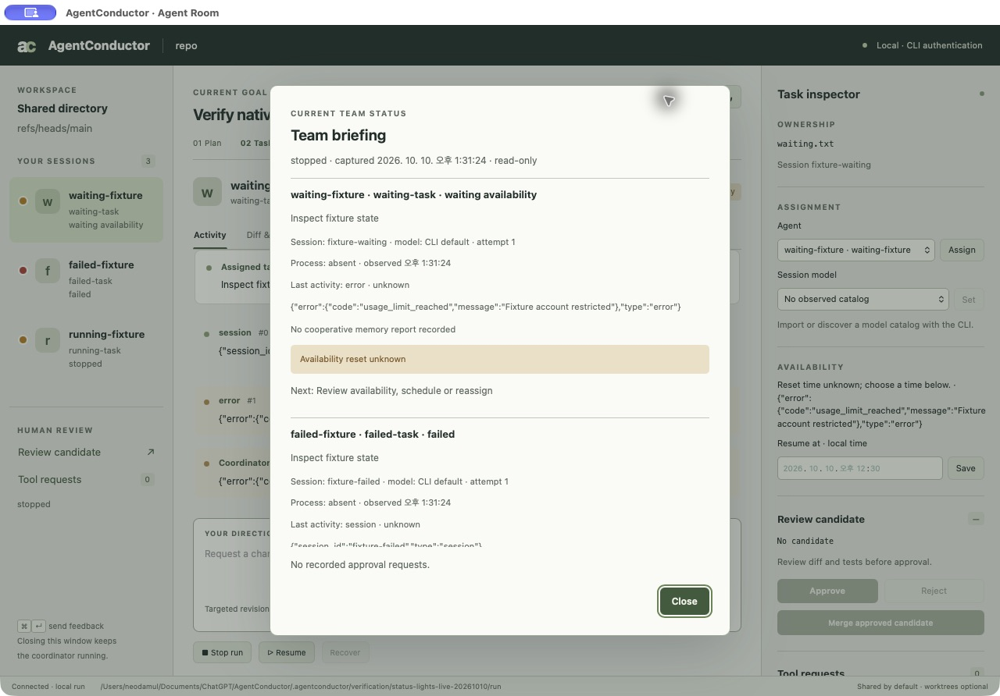

# Read-only team briefing

Trace: R-28 -> BG-12 -> SF-22 -> UC-19 -> QAS-20 -> DD-30.

## Contract and evidence

The CLI `briefing` and native `Brief team` return the same bounded factual bundle. SQLite is opened read-only in a deferred transaction; schema initialization, workflow mutation and UI broker polling are excluded. All workflow/events/cooperative reports/tool receipts share a database snapshot. Kernel PID/group probes are separately timestamped; presence alone cannot establish process identity or progress. An absent process conflicting with a recorded running task produces explicit recovery advice, never an automatic state change.

Normalized event observation times are persisted atomically with events. Legacy timestamps remain unknown. Cooperative reports must match agent/task/attempt/session, expose only named bounded fields and show recent/stale/future/unknown status. They remain agent observations, not tool/merge permissions. There is no outbound memory/LLM request in a briefing query; manual exact-ID cooperative report ingestion is now verified through the [memory transport](memory-transport.md); automatic worker collection remains unfinished.

TDD: missing briefing/read-only API failed first. Six integration tests prove all-session coverage, no missing-run creation, read-only writes refused, stale report versus absent process, concurrent snapshot consistency, foreign/future reports and private-field exclusion, plus CLI/native parity and unsupported request fields rejected.

Final full regression: 169 passed / 4 ignored / 0 failed, 44 suites, 99.32 seconds. Clippy/rustfmt/JS checks passed. Native retained fixture: Brief team displayed waiting, failed and stopped sessions; process absence, unknown legacy activity times, unavailable memory reports and next actions were explicit. The window exited 0; PID49618 kernel-absent; workflow revision and main SQLite SHA-256 unchanged. Local evidence under `.agentconductor/verification/team-briefing/`.

Graphify: 1,160 nodes/2,664 edges, no LLM. CocoIndex structural grep located read_only_snapshot. No Cargo dependency added. Host Python's auxiliary read-only SQLite connection failed to open the existing database; the actual Rust CLI and native read-only query succeeded. Verification therefore used the product query, revision and file hash rather than claiming the auxiliary Python connection worked.

Remaining: automatic worker cooperative report ingestion/acknowledgment (R-27), active multi-provider observations, tool approval expiration presentation, measured resources and Windows primitives/UI. This checkpoint does not complete the product.

## Source fingerprints

| Source | SHA-256 |
| --- | --- |
| `src/briefing.rs` | `758417184d0ca7ed8915adb5dbf034e04c2e3e3e8d55ac489187b0e235d53bd9` |
| `src/state.rs` | `c629dacc614feb2bcd8d38a0a277ccc2b14991a97710041d9ed35ac27c32f617` |
| `src/main.rs` | `fa66d4ab1762fc6cea807546ea49f376f17eed39669b0867a96fb74d9bcfcce3` |
| `src/ui.rs` | `317ce80b8632c90fcfb3ae2a1ffb6d2ab4f1a75470716dc53931c97e674934b0` |
| `src/ui/room.html` | `54a285160488a7f0a54b6cc7166f0f9972b39be38d7910b06b7b2e8363bd7d51` |
| `src/ui/room.js` | `9821f79241250f01fb783a5e5b2dd980b481849f48d20f901ed6a0859e3ec90d` |
| `tests/briefing.rs` | `1634e9e2fbc27ac80743acb0e62e52d4807f0725e5a0689fab303f7bf648f6d4` |
| `docs/assets/ui-team-briefing-native.jpg` | `f4aded86d7a4cb87a3732f37e2b628159b16073af87b69ad7f07ee5699202f3f` |
